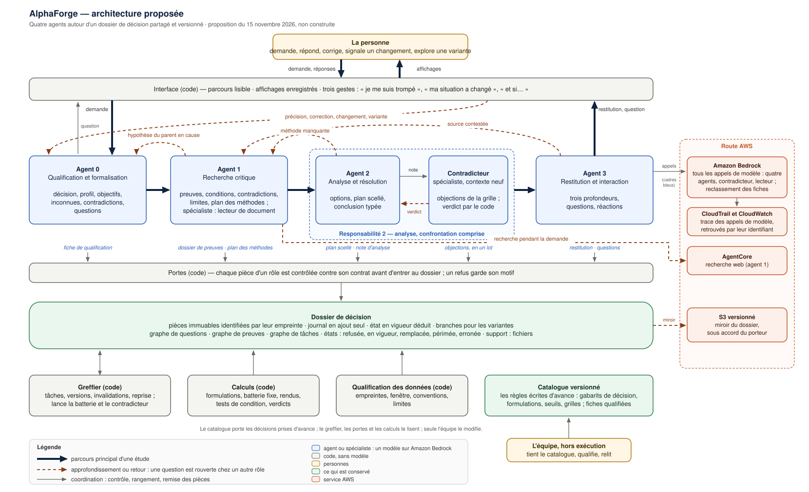
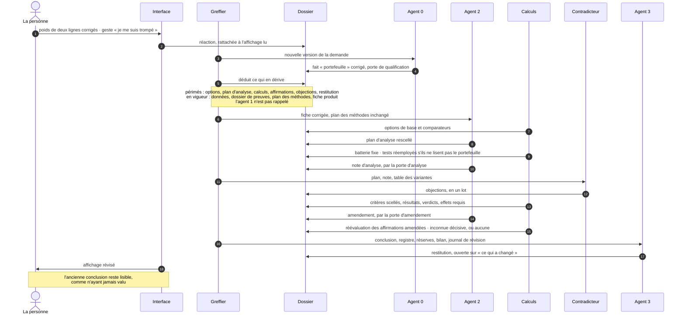
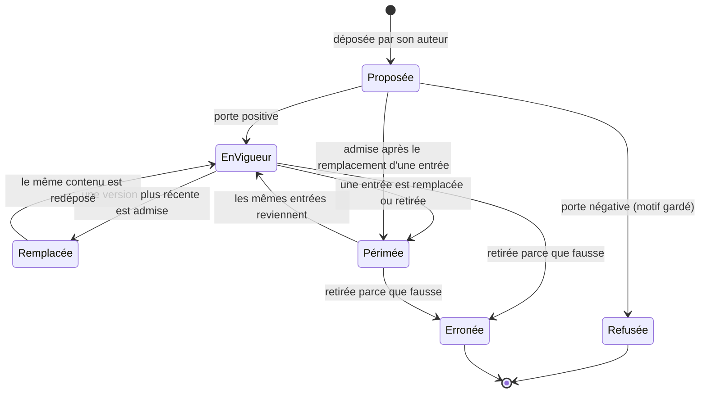

> **Conception, non construite** (15 novembre 2026). Rien de ce document n'est en service dans le produit. Les passages sur le calendrier, les décisions à prendre et l'organisation du travail sont historiques : ce ne sont pas des consignes. Certaines pièces de travail citées (`research/fiches/`, `research/R08-…`, `docs/etat.md`, `docs/coordination.md`) ne sont pas dans cette archive. Entrée de l'archive : `LIRE_EN_PREMIER.md`.

# 08 — Schémas

Trois schémas. Le premier est un dessin (SVG et PNG) ; les deux autres sont écrits en Mermaid, que GitHub et la plupart des éditeurs affichent, et rendus aussi en images dans `schemas/`. Ils correspondent aux contrats des documents 02, 03 et 04 ; en cas d'écart, les contrats priment.

## 1. Architecture d'ensemble

Fichiers : `schemas/architecture.svg` (à ouvrir dans un navigateur) et `schemas/architecture.png`. Le dessin est produit par `research/outils/schema_architecture.py` ; il se régénère par `uv run python research/outils/schema_architecture.py`.

Lecture :

- **flèches épaisses** : l'ordre des tâches d'une étude, de la demande à la restitution ;
- **flèches en pointillé** : les approfondissements et les retours, c'est-à-dire une question rouverte chez un autre rôle ; deux pointillés ont un autre sens, un appel d'outil (la recherche pendant la demande) et une copie soumise à accord (le miroir) ;
- **flèches fines** : la coordination ; toute pièce d'un rôle passe par une porte avant d'entrer au dossier, et le greffier remet à chaque rôle ses pièces en vigueur ;
- cadres bleus : les quatre agents et le contradicteur, qui sont des modèles sur Amazon Bedrock ; le lecteur de document, second spécialiste, n'a pas de cadre à lui : il est nommé dans celui de l'agent 1 ; cadres gris : du code, sans modèle ; cadres beiges : des personnes ; cadres verts : ce qui est conservé ; cadres orange : des services AWS.

Aucune flèche, épaisse ou en pointillé, n'est un message d'un rôle à un autre : chaque rôle dépose des pièces et des événements, et reçoit ses pièces du greffier.

Ce que le schéma dit de la place du contradicteur et de l'organisation. Le contradicteur est à l'intérieur de la responsabilité 2, en boucle latérale : il reçoit la note, il rend des objections, et le verdict que le code en tire revient à l'agent 2. Il n'a aucune sortie vers la personne ni vers un autre agent ; c'est la conclusion de l'agent 2, amendée s'il y a lieu, qui part vers l'agent 3. C'est une cinquième conversation de modèle, lancée par le greffier, et non une cinquième responsabilité ; le lecteur de document, spécialiste de l'agent 1, en est une sixième quand un texte est téléchargé. Les fonctions d'organisation (portes, greffier, calculs et batterie fixe, qualification des données) n'ont que des flèches de coordination ; l'interface, sixième fonction, porte l'entrée et la sortie du parcours. Aucun modèle n'y décide, et les règles qu'elles appliquent viennent du catalogue, que seule l'équipe modifie. Les personnes interviennent à deux endroits : la personne servie, par l'interface, pendant l'étude ; l'équipe, par le catalogue et par ses relectures, hors exécution. Le miroir S3 est en pointillé parce qu'il dépend d'un accord.

Ce que le dessin ne montre pas, pour rester lisible : les outils de chaque agent (ils sont listés au point 3 de chaque contrat) ; le lecteur de document comme un cadre à part ; et le fait que la trace tenue par AWS ne couvre ni le reclassement ni la recherche web.

## 2. Révision après une nouvelle information

Cas : la personne corrige la composition de son portefeuille après avoir lu la restitution (document 07, parcours 1). Image : `schemas/revision-sequence.svg`.

Trois variantes du même parcours. Une **précision** (la réponse à la question posée après l'analyse, ou une part choisie dans le domaine déjà balayé) ne périme aucun calcul : les étapes 6 à 15 n'ont pas lieu ; le code sélectionne le cas, puis l'agent 3 restitue. Si la personne avait dit « ma situation a changé », la révision serait la même, et l'ancienne conclusion serait montrée comme ayant valu jusqu'à cette date. Si elle avait choisi « et si… », l'étape 5 ne périmerait rien : le greffier ouvrirait une branche, et la branche principale garderait sa tête.

## 3. États d'une pièce

Image : `schemas/etats-d-une-piece.svg`.

« Proposée » n'est pas un état durable : c'est l'instant qui précède la porte. « Périmée » est un état calculé : il se défait si les mêmes entrées reviennent. « Remplacée » dit qu'une version plus récente de la même pièce existe à cette tête ; si la personne revient à l'ancienne valeur, la pièce redevient en vigueur, et ce qui en dérivait aussi, sans recalcul. « Erronée » est un retrait : il ne se défait pas. Une fiche de preuve porte en plus un statut de qualification, « qualifiée » ou « candidate », qui n'est pas un état : une preuve candidate est en vigueur, et ne peut servir qu'à rendre l'analyse plus prudente (document 03).
