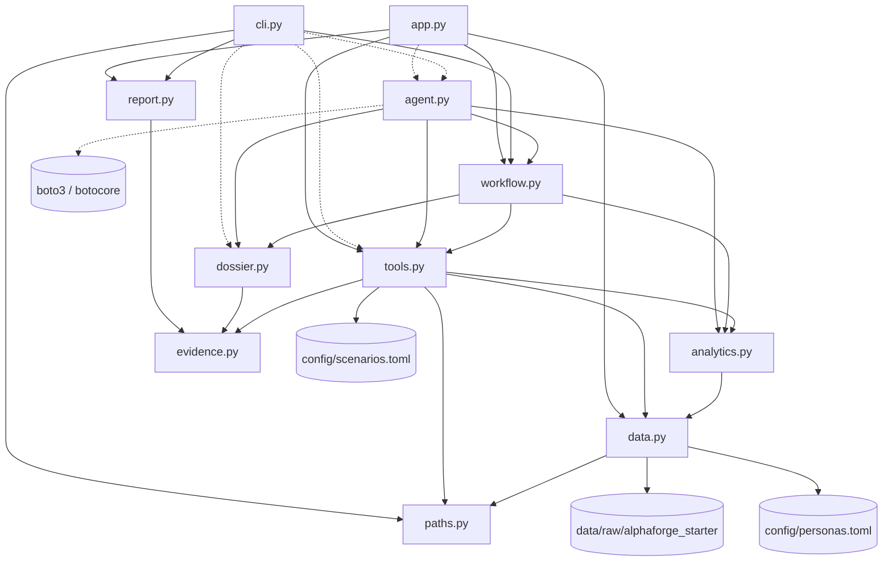

> **Annexe détaillée**, rédigée le 15 novembre 2026 pour une première archive. Les sections 4 à 9 de la présentation, les dépendances, la reproduction et l'index des preuves n'ont pas été contre-vérifiés par un second lecteur. Le `MANIFESTE.json` cité ici est celui de la racine de cette archive ; `runs/_archives/`, `inventaire/`, `outils/`, `CAPACITES.csv`, `docs/etat.md`, `docs/coordination.md`, `research/R08-…` et `research/fiches/` ne sont pas joints. En cas de désaccord, le code puis `LIRE_EN_PREMIER.md` priment.

# Carte des dépendances et couplages

Document établi le 15 novembre 2026 par lecture du code (imports, appels) et des preuves de `evaluation-fusion/preuves/`. Les chemins sont relatifs à la racine du dépôt. Les identifiants `X-CAP-nnn` renvoient à `evaluation-fusion/CAPACITES.json`, dont les états sont repris tels quels.

Trois strates, jamais confondues : (1) produit implémenté (`src/datathon2026/`) ; (2) recherche et expériences hors produit (`research/`, `docs/refonte/`) ; (3) architecture cible à quatre agents, à l'état de conception, non construite (`docs/refonte/architecture/`). États employés : Proposé, Conçu, Implémenté, Exécuté, Vérifié. Ce sont des états d'avancement, pas des notes de qualité.

## 1. Dépendances réelles

### 1.1 Graphe des modules du produit (strate 1, état : Implémenté)

Fait observé : graphe établi par `grep` des imports de `src/datathon2026/*.py`. Aucun cycle. Les flèches en pointillé sont des imports différés, faits dans une fonction.

| Module (lignes) | Importe du paquet | Bibliothèques externes | Importé par | Référence |
|---|---|---|---|---|
| `paths.py` (11) | rien | bibliothèque standard | `data`, `tools`, `cli` | `paths.py:6-11` |
| `evidence.py` (347) | rien | bibliothèque standard (`re`, `dataclasses`) | `dossier`, `report`, `tools`, `tests/test_evidence.py` | `evidence.py:11-13` |
| `data.py` (96) | `paths` | `pandas`, `tomllib` | `analytics`, `tools`, `app` | `data.py:12-17` |
| `analytics.py` (198) | `data` | `numpy`, `pandas` | `tools`, `workflow`, `agent` | `analytics.py:18-21` |
| `tools.py` (284) | `analytics`, `data`, `evidence.Registry`, `paths` | `numpy`, `hashlib`, `tomllib` | `workflow`, `agent`, `cli`, `app` | `tools.py:12-17` |
| `dossier.py` (126) | `evidence` (`Claim`, `Record`, `Registry`, `verify_claims`) | bibliothèque standard | `workflow`, `agent`, `cli` | `dossier.py:10` |
| `report.py` (564) | `evidence` (huit symboles, dont le privé `_DECIMALS`) | bibliothèque standard | `cli`, `app` | `report.py:16` |
| `workflow.py` (227) | `analytics`, `tools`, `dossier.Dossier` | aucune | `agent` (pour `underwater` seulement), `cli`, `app` | `workflow.py:10-12`, `agent.py:20` |
| `agent.py` (325) | `analytics`, `tools`, `dossier` (`SECTIONS`, `Dossier`), `workflow.underwater` | `boto3`, `botocore` (import différé) | `cli`, `app` (import différé) | `agent.py:17-20`, `agent.py:39-40` |
| `cli.py` (159) | `report`, `workflow`, `paths` ; différés : `tools`, `agent`, `dossier` | `botocore.exceptions` (différé) | point d'entrée `alphaforge` | `cli.py:9-10`, `cli.py:49-52`, `cli.py:81`, `pyproject.toml` (`[project.scripts]`) |
| `app.py` (373) | `data`, `report`, `workflow`, `tools` ; différé : `agent` | `http.server` (bibliothèque standard) | `scripts/lancer-app.sh` | `app.py:20-23`, `app.py:90` |

Faits observés à noter :
- `evidence.py` et `paths.py` sont les deux seules feuilles sans dépendance interne.
- `agent.py` dépend de `workflow.py` pour une seule fonction de tracé, `underwater` (`workflow.py:36`, appelée en `agent.py:293`).
- `report.py` ne dépend ni de `dossier.py` ni de `tools.py` : il lit le dictionnaire produit par `Dossier.to_dict` (`report.py:482-484`).
- `boto3` n'est chargé qu'à la création d'un client (`agent.py:38-45`) : `alphaforge demo`, `alphaforge rendre` et le mode « Calcul de référence » de l'application s'exécutent sans AWS.

### 1.2 Dépendances hors produit vers le produit (strate 2, état : Exécuté)

Fait observé (`grep` des imports sous `research/` et `docs/refonte/`) : sept scripts importent le paquet `datathon2026`.

| Script | Symboles du produit employés |
|---|---|
| `research/experiences/methodes_analyse.py`, `ecart_et_niveau.py`, `multivers_exploratoire.py`, `rendement_d_equilibre.py`, `dossier_illustratif.py`, `parcours_contraste.py`, `docs/refonte/calcul_exploratoire.py` | `T.Session().market` (`weekly_returns`, `daily`), `T.load_scenarios()`, `a.blend`, `a.portfolio`, `a.cagr`, `a.worst_window`, `data.load_universe`, `data.load_prices`, `data.load_macro`, `data.adj_close_wide`, `T.share_sweep`, `workflow.robert` |

N'importent rien du produit : `research/experiences/calibration_reechantillonnage.py` (`numpy` seul), `research/experiences/modele_qualification_et_citations.py` (`boto3`), tout `research/experiences/technique/` (prototype du dossier, essais LangGraph, Strands, services AWS), `research/outils/*.py`, `scripts/comparer_agent_workflow.py` (lit `runs/*/dossier.json`). Le sens inverse n'existe pas : aucun module de `src/datathon2026/` n'importe quoi que ce soit de `research/` ou de `docs/`.

### 1.3 Dépendances externes

| Élément | Exigence déclarée | Version figée | Référence |
|---|---|---|---|
| Python | `>=3.12` | `3.13` (`.python-version`) | `pyproject.toml` |
| `boto3` | `>=1.44.3` | 1.44.3 (`botocore` 1.44.3) | `pyproject.toml`, `uv.lock` |
| `numpy` | `>=2.0` | 2.5.4 | idem |
| `pandas` | `>=2.2` | 3.1.1 | idem |
| `pytest` (groupe `dev`) | `>=8.0` | 9.2.0 | idem |
| Construction | `hatchling` | non relevée | `pyproject.toml` (`[build-system]`) |

Bibliothèques employées par les expériences et absentes de `pyproject.toml` (fait observé par les imports) : `arch` et `scikit-learn`, chargées par `uv run --with` (`research/experiences/methodes_analyse.py:4`) ; `prov`, facultative (`research/experiences/technique/dossier_maison/LISEZMOI.md`) ; `langgraph`, `langchain_aws`, `langsmith`, `pydantic` (`technique/langgraph/`) ; `strands`, `opentelemetry` (`technique/strands/`) ; `moto` (`technique/services_aws/essai6_emulation_locale.py`). Leurs versions ne sont pas dans `uv.lock` ; celles des essais sont notées dans les `LISEZMOI.md` de `research/experiences/technique/`.

### 1.4 Données attendues

- Emplacement : `data/raw/alphaforge_starter/`, remplaçable par la variable `DATATHON_STARTER_DIR` (`paths.py:9`).
- Fichiers lus par le produit : `prices_daily.csv`, `fx_usdcad_daily.csv`, `assets_universe.csv` (`data.py:30-49`, empreintes prises en `tools.py:78-79`). `corporate_actions.csv` et `macro_rates.csv` ont un chargeur (`data.py:44`, `data.py:52`) qu'aucun module du produit n'appelle.
- Colonnes supposées : `date`, `ticker`, `adj_close`, `currency` pour les prix ; `date`, `usdcad` pour le change (`analytics.py:52-60`) ; `ticker`, `name`, `asset_class`, `currency`, `sector` pour l'univers (`agent.py:149`).
- Les données ne sont ni suivies par git (`.gitignore`, `data/raw/*`) ni incluses dans l'archive ; leurs empreintes sont dans `evaluation-fusion/MANIFESTE.json` (`donnees_non_incluses`).

### 1.5 AWS

| Paramètre | Valeur par défaut | Remplacement | Référence |
|---|---|---|---|
| Modèle | `global.anthropic.claude-sonnet-5-5` | `AF_BEDROCK_MODEL`, `--modele` | `agent.py:22`, `cli.py:130` |
| Région | `us-east-1` | `AWS_REGION`, `AWS_DEFAULT_REGION`, `--region` | `agent.py:23` |
| Profil | `alphaforge` | `AF_AWS_PROFILE`, `AWS_PROFILE`, `--profil` ; repli sur la chaîne d'identifiants par défaut | `agent.py:26`, `agent.py:42-45` |
| Services appelés | `bedrock-runtime` (`converse`) ; `sts` et `bedrock` en lecture seule pour `aws-verifier` | — | `agent.py:140`, `agent.py:174`, `cli.py:96-106` |

Fait observé : accès constaté le 15 novembre (`evaluation-fusion/preuves/aws-verifier.txt`). Fait rapporté par `docs/refonte/architecture/00-synthese.md:118` : fermeture des comptes AWS le 16 novembre à 13 h 59. Après cette date, tout appel de modèle demande un autre compte.

## 2. Les sept rubriques, par contribution

### 2.1 Vérificateur de preuves et registre — X-CAP-028, 045, 046, 047, 048, 049, 067

| Rubrique | Contenu |
|---|---|
| États (CAPACITES.json) et strate | Vérifié pour 028, 045 à 048 ; Exécuté pour 049 et 067. Strate 1. |
| Dépendances indispensables | Aucune interne ; bibliothèque standard (`evidence.py:11-13`). |
| Composants interchangeables | Le producteur des enregistrements : tout code appelant `Registry.add(prefix, label, value, unit, status, origin, **kw)` (`evidence.py:226`). Le rendu : `Registry.render` (texte) ou `report.render_html` (HTML). |
| Hypothèses communes | Textes en français : garde lexicale, grandeurs en lettres, accord en genre (`evidence.py:48-71`, `110-155`) ; identifiants `[A-Z]-\d{4}` (`evidence.py:40`) ; sept unités numériques (`evidence.py:42`) ; six statuts ordonnés (`evidence.py:17`). |
| Effets de bord | Aucun : fonctions pures, aucune écriture. |
| À transférer ensemble | `evidence.py`, `tests/test_evidence.py` ; si le dossier est repris, `dossier.py`, qui porte l'extension aux chiffres clés et aux tableaux (`dossier.py:53-73`). |
| Extraction autonome | Oui : module sans import interne. |
| Difficultés de remplacement | La liste des tournures refusées est recopiée dans l'instruction système (`agent.py:109`) ; le motif d'identifiant est redéfini en `report.py:28` ; le rendu existe deux fois (`evidence.py:241-264`, `report.py:69-90`) : un nouveau type de référence se code aux deux endroits. |

### 2.2 Session et outils de calcul — X-CAP-044, 017, 007, 001, 015, 016, 066

| Rubrique | Contenu |
|---|---|
| États (CAPACITES.json) et strate | Vérifié pour 044, 017, 007, 015, 016 ; Exécuté pour 001 et 066. Strate 1. |
| Dépendances indispensables | `evidence.Registry` (`tools.py:16`, 37 appels à `add` dans `tools.py`) ; `analytics.Market` et ses fonctions ; `config/scenarios.toml` (table `groupes`, `tools.py:39`) ; `config/personas.toml` (`tools.py:98`) ; les trois fichiers de données. |
| Composants interchangeables | La table ticker → groupe (argument `groups` de `Session`, `tools.py:34`) ; les conventions (`Session.conv`) ; l'appelant (enchaînement fixe ou agent, même interface `Session.call`). |
| Hypothèses communes | Poids positifs de somme 1 (`tools.py:64-69`) ; libellés français qui servent de clés à d'autres modules (voir difficultés) ; trois profils nommés (`tools.py:100`). |
| Effets de bord | Créer une `Session` relit les CSV et calcule le marché (`tools.py:37`) ; chaque outil ajoute des enregistrements et une ligne de trace (`tools.py:45-53`). Aucune écriture sur disque. |
| À transférer ensemble | `tools.py`, `evidence.py`, `analytics.py`, `data.py`, `paths.py`, `config/*.toml`. |
| Extraction autonome | Non : les outils ne rendent que des identifiants et des valeurs formatées (`tools.py:56-57`), plus `_brut` pour trois d'entre eux. |
| Difficultés de remplacement | `agent._chart` retrouve des enregistrements par le début de leur libellé (`agent.py:283`, `301`, `308-309`) et la fiche de profil par libellé exact (`agent.py:34-35`, `259-260`) : renommer un libellé vide un graphique ou la fiche sans erreur. `workflow.py` lit les clés de sortie (`poids_<ticker>`, `groupe_risque_<groupe>`, `_brut`). |

### 2.3 Calculs et données — X-CAP-009 à 014, 064, 065

| Rubrique | Contenu |
|---|---|
| États (CAPACITES.json) et strate | Vérifié pour 009, 012, 013, 014, 064, 065 ; Exécuté pour 010 et 011. Strate 1. |
| Dépendances indispensables | `numpy`, `pandas` ; `data.py` ; le jeu de départ. |
| Composants interchangeables | Les tableaux de prix et de change, injectables (`Market(conv, prices, fx)`, `analytics.py:46`) ; la devise de base, CAD ou USD seulement (`analytics.py:47`). |
| Hypothèses communes | Période fixée dans le code, du 2021-11-12 au 2026-11-12 (`analytics.py:29-30`) ; semaine se terminant le vendredi ; volatilité = écart type hebdomadaire × √52 (`analytics.py:97`) ; rendements simples ; rééquilibrage hebdomadaire ; toute devise autre que la base est convertie par le taux USD/CAD (`analytics.py:55-59`). |
| Effets de bord | Lecture de fichiers seulement. |
| À transférer ensemble | `analytics.py`, `data.py`, `paths.py`, `tests/test_analytics.py`, `tests/test_data.py`. |
| Extraction autonome | Oui pour les fonctions de mesure (`cagr`, `annual_vol`, `max_drawdown`, `worst_window`, `portfolio`, `blend`) : elles prennent des séries `pandas` et ne connaissent pas le registre. `Market` exige le format du jeu de départ. |
| Difficultés de remplacement | Changer une convention modifie toutes les valeurs des dossiers enregistrés sous `runs/` et les attentes des tests. Les sept scripts d'expériences du 1.2 lisent `Market.weekly_returns`. |

### 2.4 Boucle d'agent Bedrock — X-CAP-034, 035, 071, 026, 008

| Rubrique | Contenu |
|---|---|
| États (CAPACITES.json) et strate | Vérifié pour 034, 035, 071, 026 ; Exécuté pour 008. Strate 1. |
| Dépendances indispensables | `tools.Session` et les sept outils inscrits (`agent.py:31-33`, `146-170`) ; `Dossier.verification` comme critère d'acceptation (`agent.py:215`) ; `boto3` ; un compte Bedrock. |
| Composants interchangeables | Le client, injecté par argument (`agent.py:137-141`), remplacé par `FakeBedrock` dans `tests/test_agent.py:9` ; le modèle, la région, le profil (1.5). |
| Hypothèses communes | Forme des réponses de l'API Converse : `output.message`, `stopReason == "tool_use"`, blocs `toolUse`, `usage`, `metrics`, `ResponseMetadata.RequestId` (`agent.py:181-187`, `204-213`). Bornes : 16 tours, 2 corrections, 8 192 jetons de sortie (`agent.py:27-29`). |
| Effets de bord | Appels facturés ; aucun fichier écrit par `agent.py` (l'écriture est dans `cli.save`). |
| À transférer ensemble | `agent.py`, `tools.py`, `dossier.py`, `evidence.py`, `workflow.underwater`, `tests/test_agent.py`. |
| Extraction autonome | Partielle : `_converse` (`agent.py:172-188`) est une enveloppe autonome autour de l'appel ; la boucle `run` ne l'est pas. |
| Difficultés de remplacement | Après deux corrections, un dossier encore en échec est rendu à l'appelant avec `accepte: false` (`agent.py:217-218`) : le contrôle signale, il ne bloque pas. Fait observé : exécutions faites sur un seul modèle (`evaluation-fusion/preuves/agent-robert-mesures.txt`). Comportement sur un autre modèle : Non mesuré. |

### 2.5 Schéma `soumettre_dossier` et instruction système — X-CAP-043, 077, 002

| Rubrique | Contenu |
|---|---|
| États (CAPACITES.json) et strate | Vérifié pour 043 ; Exécuté pour 077 et 002. Strate 1. |
| Dépendances indispensables | `dossier.SECTIONS` (énumération du schéma, `agent.py:80`) ; la grammaire `{{…}}` et la garde lexicale de `evidence.py` ; les noms d'outils de `TOOL_SPECS` (`agent.py:51-96`). |
| Composants interchangeables | Le texte de l'instruction (`agent.py:98-127`), tant qu'il décrit le vérificateur réellement en place. |
| Hypothèses communes | Un seul message initial, sans étage de qualification (`agent.py:195-200`) ; hypothèses de démonstration transmises en JSON ; trois profils (`agent.py:55`) ; deux types de graphique (`agent.py:92`). |
| Effets de bord | Aucun en propre. |
| À transférer ensemble | `SYSTEM`, `TOOL_SPECS`, `_build`, `_chart` (`agent.py:242-325`), `evidence.py`, `dossier.py`. |
| Extraction autonome | Non : l'instruction énumère des règles que seul ce vérificateur contrôle. |
| Difficultés de remplacement | Liste lexicale dupliquée (`agent.py:109`, `evidence.py:48-56`) : une modification d'un côté rend l'autre faux, sans test qui le signale (Interprétation, d'après la lecture de `tests/`). |

### 2.6 Dossier et `dossier.json` — X-CAP-050, 051, 070, 052

| Rubrique | Contenu |
|---|---|
| États (CAPACITES.json) et strate | Vérifié pour 050 ; Exécuté pour 051 et 070 ; Proposé pour 052. Strate 1. |
| Dépendances indispensables | `evidence.py` (`dossier.py:10`). |
| Composants interchangeables | Le producteur : enchaînement fixe, agent, ou tout code qui remplit un `Dossier` par `add` (`dossier.py:46`). |
| Hypothèses communes | Clés françaises du JSON (`dossier.py:77-104`) ; huit sections (`dossier.py:12-21`) ; objets `chiffres_cles`, `tableaux`, `graphiques`, `fiche_profil`, `aws`, `trace`. |
| Effets de bord | `Dossier.save` crée le répertoire et écrase `dossier.json` (`dossier.py:122-126`). |
| À transférer ensemble | `dossier.py`, `evidence.py`, `report.py`, `cli.save` et `cli.rerender` (`cli.py:20-29`, `77-83`). |
| Extraction autonome | Oui avec `evidence.py` : `from_dict` reconstruit et revérifie sans calcul ni modèle (`dossier.py:106-120`). Fait observé : huit dossiers revérifiés hors ligne (`evaluation-fusion/preuves/rendre.txt`). |
| Difficultés de remplacement | Aucun numéro de version dans le format. `from_dict` remplit `records` sans passer par `add` (`dossier.py:111-112`) : les compteurs restent à zéro, donc ajouter un enregistrement à un dossier relu réemploierait un identifiant existant (Interprétation, non essayée). Un seul fichier écrasé à chaque exécution : pas d'historique, pas de branche. |

### 2.7 Rendu HTML — X-CAP-056, 057

| Rubrique | Contenu |
|---|---|
| États (CAPACITES.json) et strate | Exécuté. Strate 1. |
| Dépendances indispensables | Le dictionnaire de `Dossier.to_dict` ; huit symboles de `evidence.py`, dont `_DECIMALS`, privé (`report.py:16`). |
| Composants interchangeables | La feuille de style et le script, en ligne dans le fichier (`report.py:383`, `454`) ; le lecteur du HTML (fichier ou `iframe` de l'application). |
| Hypothèses communes | Types de graphique `ligne` et `barres`, trois séries au plus (`report.py:140`, `195`, `489`) ; sections et intitulés propres au rendu (`report.py:471-479`) ; source des données écrite en dur (`report.py:27`). |
| Effets de bord | Aucun : `render` rend une chaîne ; l'écriture est dans `cli.py`. |
| À transférer ensemble | `report.py`, `evidence.py`, le format de `dossier.json`. |
| Extraction autonome | Oui à partir d'un `dossier.json` conforme : aucun calcul, aucun réseau. |
| Difficultés de remplacement | Les intitulés de section existent en trois endroits (`dossier.py:12-21`, `report.py:471-479`, `agent.py:121`). Une clé absente du dictionnaire lève `KeyError` pour les champs lus sans valeur par défaut (`report.py:483-487`, `516-518`). |

### 2.8 Enchaînement fixe — X-CAP-036, 027, 037

| Rubrique | Contenu |
|---|---|
| États (CAPACITES.json) et strate | Vérifié pour 036 ; Exécuté pour 027 et 037. Strate 1. |
| Dépendances indispensables | `tools.py`, `analytics.blend` et `portfolio`, `Dossier` ; clés de `config/scenarios.toml` (`workflow.py:46-48`, `57`, `61`, `132`, `137-141`). |
| Composants interchangeables | Le scénario et la session, passés en argument (`workflow.py:42`, `128`). |
| Hypothèses communes | Deux cas seulement, Robert et Amira (`workflow.py:227`) ; noms de groupes « Technologie » et « Cryptoactifs » en dur (`workflow.py:133`) ; quatrième préférence d'Amira citée par son rang (`workflow.py:156`). |
| Effets de bord | Aucun en propre ; `cli.save` écrit. |
| À transférer ensemble | `workflow.py`, `config/scenarios.toml`, `config/personas.toml`, `tools.py`, `tests/test_workflow.py`. |
| Extraction autonome | Non : les gabarits sont écrits pour ces deux scénarios. |
| Difficultés de remplacement | Sert de repli sans AWS et de base de comparaison (`scripts/comparer_agent_workflow.py:15`) ; `agent.py` lui emprunte `underwater`. Aucun enchaînement fixe pour Mateo ni pour une demande libre (`app.py:100-103`). |

### 2.9 Application locale — X-CAP-058, 059, 060, 061

| Rubrique | Contenu |
|---|---|
| États (CAPACITES.json) et strate | Vérifié pour 058 et 061 ; Implémenté pour 059 ; Exécuté pour 060. Strate 1. |
| Dépendances indispensables | `workflow.WORKFLOWS`, `BedrockAgent.run`, `Dossier.to_dict`, `report.render`, `tools.load_scenarios`, `data.load_universe`, `data.load_personas` (`app.py:22-23`, `90`, `98`, `104-108`, `121-123`). |
| Composants interchangeables | Le port (`--port`, `app.py:357`) ; la page, chaîne en ligne (`app.py:139`). |
| Hypothèses communes | Un calcul à la fois (`_LOCK`, `app.py:26`, `88`) ; bornes de saisie en dur (`app.py:56-73`) ; écoute sur `127.0.0.1` seulement (`app.py:360`). |
| Effets de bord | Serveur local sur le port 8765 ; en mode agent, appels facturés. Fait observé : `app.py` n'écrit aucun fichier, le dossier est rendu dans la réponse HTTP (`app.py:105-116`). |
| À transférer ensemble | `app.py`, `tests/test_app.py`, `scripts/lancer-app.sh`, plus tout le lot du produit. |
| Extraction autonome | Non. |
| Difficultés de remplacement | `build_scenario` et `bootstrap` lisent des clés précises de `scenarios.toml` (`app.py:54-74`, `124-135`). L'historique de séance (X-CAP-059) vit dans la page et n'est pas enregistré côté serveur. |

### 2.10 Ligne de commande — X-CAP-062, 051, 072

| Rubrique | Contenu |
|---|---|
| États (CAPACITES.json) et strate | Exécuté. Strate 1. |
| Dépendances indispensables | `Dossier.save`, `Dossier.from_dict`, `report.render`, `report.render_index`, `workflow.WORKFLOWS`, `agent` (`cli.py:9`, `52`, `81`, `90`). |
| Composants interchangeables | Le répertoire de sortie (`--sortie`, `cli.py:139`). |
| Hypothèses communes | Un sous-répertoire par nom de scénario (`cli.py:22`) ; trois profils (`cli.py:127`). |
| Effets de bord | Écrit et écrase `<sortie>/<scénario>/dossier.json`, `dossier.html` et `<sortie>/index.html` (`cli.py:23-25`, `41-42`, `151`) ; `--ouvrir` lance le navigateur. |
| À transférer ensemble | `cli.py`, `dossier.py`, `report.py`. |
| Extraction autonome | `aws_check` (`cli.py:86-118`) ne dépend que de `agent.aws_session` et des constantes par défaut. |
| Difficultés de remplacement | `save` lit `verification` dans le dictionnaire (`cli.py:26-28`) : un dossier sans ce champ fait échouer la commande. |

### 2.11 Preuve d'appel AWS — X-CAP-069, 070, 072, 073

| Rubrique | Contenu |
|---|---|
| États (CAPACITES.json) et strate | Vérifié pour 069 ; Exécuté pour 070, 072, 073. Strate 1. |
| Dépendances indispensables | `BedrockAgent._converse` (`agent.py:181-187`) ; champ `aws` du dossier (`agent.py:237-238`, `dossier.py:35`) ; bloc de rendu (`report.py:505-514`). |
| Composants interchangeables | La source de la latence : `metrics.latencyMs`, sinon l'horloge locale (`agent.py:186`). |
| Hypothèses communes | Le service renvoie un `RequestId` et des comptes de jetons. |
| Effets de bord | Aucun en propre. |
| À transférer ensemble | `agent.py:172-188` et `237-238`, `report.py:505-514`. |
| Extraction autonome | Oui : enveloppe autour d'un appel et cinq champs par appel. |
| Difficultés de remplacement | L'identifiant prouve qu'un appel a eu lieu ; il n'est vérifiable par un tiers que dans les journaux du compte, lequel ferme le 16 novembre (`00-synthese.md:118`, `136`). Aucun export de ces journaux dans le dépôt : Rien. |

### 2.12 Prototype du dossier et du greffier — X-CAP-054 ; contrat X-CAP-055

| Rubrique | Contenu |
|---|---|
| États (CAPACITES.json) et strate | Vérifié pour 054, sur une chaîne jouet sans modèle ; Conçu pour 055 (conception). Strates 2 et 3. |
| Dépendances indispensables | Bibliothèque standard, dont `fcntl` (`research/experiences/technique/dossier_maison/dossier.py:19`). |
| Composants interchangeables | Les tâches et les droits, passés au constructeur (`dossier.py:62`) ; `prov`, facultatif (`export_prov.py`). |
| Hypothèses communes | Forme canonique avant empreinte ; tâches pures à entrées déclarées ; un écrivain par branche (`docs/refonte/architecture/02-dossier.md`, section 8). |
| Effets de bord | `essais.py` réécrit `sorties/` (`essais.py:329`, `352`, `464`, `489`) et travaille dans un répertoire temporaire. |
| À transférer ensemble | `dossier.py`, `chaine.py`, `essais.py`, `export_prov.py`, `LISEZMOI.md`, `sorties/`. |
| Extraction autonome | Oui : aucun import du produit, aucun modèle, aucun réseau. |
| Difficultés de remplacement | Aucun lien avec `src/datathon2026/dossier.py`, qui porte le même nom de classe pour un objet différent. `fcntl` absent sous Windows ; journal relu en entier à chaque opération ; identité des empreintes entre deux machines non établie (`06-comparatif-technique.md`, « Ce qui reste à vérifier »). |

### 2.13 Méthodes essayées hors produit — X-CAP-018 à 024, 030, 031

| Rubrique | Contenu |
|---|---|
| États (CAPACITES.json) et strate | Vérifié pour 018 à 021 et 023 ; Exécuté pour 022, 024, 030, 031. Strate 2. Aucune de ces méthodes n'est appelée par le produit. |
| Dépendances indispensables | Pour sept scripts : `T.Session().market`, `T.load_scenarios()["robert"]["portefeuille_actuel"]`, `a.blend`, le jeu de départ (1.2). `arch` et `scikit-learn` pour `methodes_analyse.py`. `numpy` seul pour `calibration_reechantillonnage.py`. |
| Composants interchangeables | La source des rendements hebdomadaires : les scripts n'emploient qu'un tableau date × actif. |
| Hypothèses communes | Rendements hebdomadaires ; graine fixe ; portefeuille fictif de Robert ; mêmes 261 semaines pour toutes les variantes (`research/R09-experiences-discriminantes-2026-11-15.md:170`). |
| Effets de bord | Sortie standard seulement, sauf redirection manuelle vers `research/experiences/sorties/` (en-têtes des scripts). |
| À transférer ensemble | Le script, sa sortie dans `sorties/`, la section correspondante de R09 qui porte le critère écrit d'avance et le verdict. |
| Extraction autonome | Oui pour `calibration_reechantillonnage.py`. Les autres demandent un remplaçant de `Market.weekly_returns`. |
| Difficultés de remplacement | Code en scripts linéaires, sans fonctions importables ni tests (Fait observé : aucun fichier de `tests/` ne les couvre). Les constats (niveaux non établis, écarts appariés seuls retenus) sont liés à cet échantillon et à ces conventions. |

### 2.14 Architecture conçue — X-CAP-040, 039, 025, 033, 041, 042, 032, 055, 063, 006

| Rubrique | Contenu |
|---|---|
| États (CAPACITES.json) et strate | Conçu, sauf 039 (catalogue) : Proposé. Strate 3, conception non construite. |
| Dépendances indispensables | Par conception : un dossier à pièces immuables, un catalogue, des portes, un moteur de calcul, une boucle par rôle (`03-contrats-des-agents.md`). Fait observé : « Aucune de ces tables n'est encore écrite » (`02-dossier.md`, section « Le catalogue »). |
| Composants interchangeables | Par conception : le moyen d'exécuter la boucle d'un rôle (appel direct ou bibliothèque d'agents, `06-comparatif-technique.md`, section 4) ; le moyen de recherche. |
| Hypothèses communes | Décisions de fond écrites d'avance par l'équipe ; aucun nombre calculé écrit par un modèle ; sens d'une comparaison établi par le code. |
| Effets de bord | Aucun : documents. |
| À transférer ensemble | Documents 02 à 05 et 09 ; le document 07 pour les exemples ; le prototype du 2.12 pour le noyau du dossier. |
| Extraction autonome | Se lisent seuls : la typologie des résultats (05), les critères de réception des familles I et K (09), les règles « tâche atomique » et « refus sur raison d'arrêt » (03). Les contrats entiers supposent le vocabulaire du dossier. |
| Difficultés de remplacement | Rien n'est exécuté de bout en bout ; `00-synthese.md`, section 11, range sous « Non établi » l'apport propre de chaque rôle et la durée d'une étude. Le produit actuel n'implémente aucun de ces contrats. |

### 2.15 Méthode de recherche documentaire — X-CAP-004, 005, 068, 003, 076

| Rubrique | Contenu |
|---|---|
| États (CAPACITES.json) et strate | Exécuté pour 004, 068, 076 ; Conçu pour 005 ; Vérifié pour 003. Strate 2. |
| Dépendances indispensables | `boto3`, profil `alphaforge`, service `bedrock-agentcore` (`research/outils/recherche_web.py:26-35`) ; `research/fiches/*.json` comme source du registre R07. |
| Composants interchangeables | Le moteur de recherche ; le modèle des essais M1 et M2 (`research/experiences/modele_qualification_et_citations.py:33`). |
| Hypothèses communes | Un résultat de recherche est un extrait, pas une lecture (`recherche_web.py`, en-tête) ; textes téléchargés non redistribués, seul leur manifeste est versé. |
| Effets de bord | `recherche_web.py` ajoute une ligne à `research/outils/journal_recherches.jsonl` et appelle AWS ; `consolider_recherche.py` réécrit des fiches, le registre et `research/sources/manifeste.json` (`consolider_recherche.py:43`, `119`, `221`). |
| À transférer ensemble | R07, `research/fiches/`, `research/sources/manifeste*.json`, R09 et `research/experiences/sorties/`. |
| Extraction autonome | `consolider_recherche.py` : bibliothèque standard seule. `recherche_web.py` : compte AWS requis. |
| Difficultés de remplacement | Les textes sources sont hors dépôt (`research/sources/textes/`, exclu) ; M2 n'est pas rejouable sans eux. Les renvois des documents de `docs/refonte/` pointent vers les fiches. |

## 3. Ce qui casse si l'on retire ou remplace un composant central

### 3.1 `evidence.Registry` et la syntaxe des références

Fait observé, appels réels : `Registry` est construit en `tools.py:32` et `dossier.py:110` ; `add` est appelé 37 fois dans `tools.py` et 2 fois dans `workflow.py` (`141`, `144`) ; `render` en `dossier.py:84` et `90` ; `verify_claims` en `dossier.py:70`.
- Retrait : les outils n'ont plus de sortie (2.2), `Dossier.to_dict` et `verification` échouent, `report.py` ne s'importe plus (`report.py:16`), la soumission de l'agent n'a plus de critère d'acceptation (`agent.py:215`). Tout le produit s'arrête.
- Remplacement de la syntaxe `{{…}}` : à reprendre dans `evidence.py:38-40`, `report.py:28` et `69-90`, les quatre fonctions d'écriture de `workflow.py:20-33`, l'instruction système (`agent.py:108-116`), la description du schéma (`agent.py:49`), et tous les `gabarit` des dossiers enregistrés sous `runs/`, qui ne se rendraient plus.
- Changement de langue : la garde lexicale, les grandeurs en lettres, l'accord et le formatage (`evidence.py:48-71`, `110-190`) sont propres au français.
- Interprétation : `add` formate sur quatre chiffres (`evidence.py:230`) et le motif en exige quatre (`evidence.py:40`) ; au-delà de 9 999 enregistrements d'un préfixe, le comportement n'a pas été essayé.

### 3.2 `tools.Session`

Fait observé : construite en `workflow.py:44` et `130`, `agent.py:142`, dans les tests, et huit fois dans les scripts d'expériences. `Session.call` est le seul point où la trace est écrite pour un appel réussi (`tools.py:45-53`).
- Retrait : plus de trace ni de lien entre un appel et ses enregistrements ; `agent._chart` ne retrouve plus ses séries (`agent.py:279-283`, `322`) ; la table des appels du rendu (`report.py:516-518`) et `scripts/comparer_agent_workflow.py` n'ont plus d'entrée ; sept scripts d'expériences ne démarrent plus.
- Remplacement : la forme de la ligne de trace (`outil`, `arguments`, `enregistrements`, `duree_ms`, `erreur`) est lue à quatre endroits ; les noms d'arguments (`name`, `ticker`, `weights`, `cap`) sont lus par `_chart`.

### 3.3 `Dossier` et `dossier.json`

Fait observé : `to_dict` est lu par `cli.save` (`cli.py:21-28`), `cli.write_index` (`cli.py:37-42`), `app.produce` (`app.py:105-113`), `report.render` et `render_index`, `scripts/comparer_agent_workflow.py`.
- Retrait : plus de fichier produit, plus de rendu, plus de commande `rendre`, plus d'application.
- Remplacement du format : les huit dossiers de `runs/` et celui de `evaluation-fusion/preuves/execution-agent-2026-11-15/` ne se relisent plus par `from_dict` ; `docs/comparaison-agent-workflow.md` n'est plus régénérable.

### 3.4 `analytics`

Fait observé : importé par `tools.py:14`, `workflow.py:10`, `agent.py:17`, et par sept scripts hors produit.
- Retrait : aucun outil ne calcule ; le produit ne produit plus que la relecture de dossiers déjà enregistrés (`rendre`, qui ne recalcule pas).
- Remplacement par un autre moteur : il doit fournir `Market` (attributs `daily`, `weekly_values`, `weekly_returns`, `universe`, `fx_age_max`, `check_tickers`), `Conventions.notes`, `portfolio` (attributs `index`, `weekly`, `risk_contrib`), `blend`, `max_drawdown`, `worst_window`, `cagr`, `annual_vol`, `period_return`. Les valeurs changent ; les tests à valeurs attendues sont à revoir.

### 3.5 Le modèle Bedrock

- Retrait : restent `demo`, `rendre` et le mode « Calcul de référence ». Disparaissent : les demandes libres, le profil de Mateo (aucun enchaînement fixe, `workflow.py:227`), le champ `aws`, et la contribution d'AWS au produit, condition d'admissibilité rappelée dans `CLAUDE.md`.
- Remplacement par un autre modèle sur Bedrock : un paramètre (1.5). Fait observé : toutes les exécutions conservées portent `global.anthropic.claude-sonnet-5-5` (`evaluation-fusion/preuves/rendre.txt`). Nombre de corrections, respect de la grammaire et coût avec un autre modèle : Non mesuré.
- Remplacement par un autre fournisseur : un client exposant `converse(modelId, system, messages, toolConfig, inferenceConfig)` et la même forme de réponse (2.4) ; sinon `_converse` et la boucle `run` sont à réécrire. `aws_check` est propre à AWS.

### 3.6 Le jeu de données

- Retrait : `Session` lève `FileNotFoundError` (`data.py:22-26`) ; ne restent que `rendre` et `tests/test_evidence.py`. Fait observé : les tests d'analyse, d'enchaînement et d'application chargent les données réelles (`tests/test_analytics.py:35`, `tests/test_workflow.py:12`, `tests/test_app.py:18`) ; ceux de l'agent aussi, par la `Session` créée par défaut (`agent.py:142`).
- Remplacement : mêmes noms de colonnes (1.4) ; devises CAD et USD seulement ; période à mettre à jour dans `analytics.py:29-30` ; « Rendement 2022 » et « 2021-2026 » écrits en dur (`tools.py:151`, `225`) ; texte du biais de l'univers en dur (`tools.py:90-92`) ; tickers cités par `config/scenarios.toml`.

### 3.7 `config/personas.toml` et `config/scenarios.toml`

- `personas.toml` : lu par `tools.profile_facts` (`tools.py:98-120`) et `app.bootstrap` (`app.py:123-129`). Champs requis : `nom`, `age`, `profil_risque`, `horizon_ans.min`, `objectif`, `experience`, `preferences`. Un quatrième profil demande aussi de modifier `tools.py:100`, `agent.py:55`, `cli.py:127` et `app.py:25`. Réordonner les préférences d'Amira change la phrase de `workflow.py:156`.
- `scenarios.toml` : lu par `Session` pour les groupes (`tools.py:39`), par `workflow.py`, `cli.py:54-58`, `app.py:42` et `121`, et par sept scripts d'expériences pour le portefeuille de Robert. Retirer `groupes` empêche toute création de `Session`. Renommer une clé de scénario lève `KeyError` dans `workflow.py` ou `app.py`. Pour l'agent, les clés hors `demande`, `titre`, `persona`, `origine_demande` sont transmises telles quelles au modèle (`agent.py:194-199`).

## 4. Lots à transférer ensemble et parties extractibles seules

### 4.1 Lots

| Lot | Contenu | État | Ce qui manque si le lot est incomplet |
|---|---|---|---|
| L1 Preuves | `evidence.py`, `tests/test_evidence.py` | Vérifié | — |
| L2 Dossier vérifiable | L1, `dossier.py`, `report.py`, `cli.save`, `cli.rerender` | Vérifié (050), Exécuté (051, 056) | Sans `report.py` : pas de lecture humaine. |
| L3 Calcul | `paths.py`, `data.py`, `analytics.py`, leurs tests, le jeu de départ | Vérifié | Sans données : rien ne s'exécute. |
| L4 Outils inscrits | L1, L3, `tools.py`, `config/*.toml` | Vérifié | Sans `config/scenarios.toml` : pas de `Session`. |
| L5 Agent | L2, L4, `agent.py`, `workflow.underwater`, `tests/test_agent.py`, un compte Bedrock | Vérifié | Sans `SYSTEM` cohérent avec `evidence.py` : corrections en boucle (Interprétation). |
| L6 Enchaînement fixe | L2, L4, `workflow.py`, `tests/test_workflow.py` | Vérifié | Sans les clés de scénario : `KeyError`. |
| L7 Interfaces | L5, L6, `cli.py`, `app.py`, `tests/test_app.py`, `scripts/lancer-app.sh` | Exécuté à Vérifié | — |
| L8 Prototype du dossier | `research/experiences/technique/dossier_maison/` entier | Vérifié sans modèle | — |
| L9 Méthodes | Scripts de `research/experiences/`, `sorties/`, R09 | Exécuté à Vérifié | Sans R09 : critères et verdicts perdus. |
| L10 Conception | `docs/refonte/architecture/00` à `10`, `schemas/` | Conçu | Lecture seule ; rien à exécuter. |
| L11 Recherche | R07, R08, `research/fiches/`, `research/sources/manifeste*.json`, `research/outils/` | Exécuté | Sans les fiches : renvois sans cible. |

### 4.2 Parties extractibles seules

| Partie | Condition | État |
|---|---|---|
| `evidence.py` | Aucune | Vérifié |
| Fonctions de mesure de `analytics.py` | Séries `pandas` indexées par date | Vérifié |
| `Dossier.from_dict` + `report.render` | Un `dossier.json` conforme | Exécuté |
| `BedrockAgent._converse` et le champ `aws` | Un client Converse | Vérifié |
| `cli.aws_check` | `boto3`, un profil | Exécuté |
| Prototype `dossier_maison/dossier.py` | Système de type Unix (`fcntl`) | Vérifié sans modèle |
| `calibration_reechantillonnage.py` | `numpy` | Vérifié |
| `research/outils/consolider_recherche.py` | Fiches au format du dépôt | Exécuté |
| Typologie des résultats, critères de réception I et K | Aucune ; documents de conception | Conçu |

## 5. Interfaces d'accueil nécessaires

Décrites du seul point de vue de cette réalisation : ce qu'un système d'accueil doit fournir pour recevoir chaque lot.

| Lot | Formes de données à fournir | Fonctions ou services à fournir | Conventions à respecter |
|---|---|---|---|
| L1 | Enregistrements : identifiant `X-0000`, libellé, valeur, unité parmi `pct`, `pp`, `days`, `weeks`, `count`, `years`, `ratio`, `text`, `date`, statut parmi six, origine ; en option sujet, période, conventions, `inputs.depend_de` (`evidence.py:193-204`) | Un producteur qui appelle `Registry.add` | Textes en français écrits en gabarits `{{…}}` ; valeurs en fraction pour `pct` (affichage × 100, `evidence.py:170-171`) |
| L2 | Affirmations `(section, gabarit, références)` ; chiffres clés, tableaux, graphiques aux formes de `dossier.py:36-42` | Un répertoire d'écriture | Huit sections ; clés françaises du JSON |
| L3 | Fichiers CSV aux colonnes du 1.4, ou deux tableaux `pandas` passés à `Market` | — | CAD ou USD ; période des `Conventions` |
| L4 | Table ticker → groupe ; profils aux champs du 3.7 | — | Poids de somme 1 ; libellés stables |
| L5 | Scénario : `persona`, `demande`, `origine_demande`, plus hypothèses libres | Client `converse` ; identifiants AWS hors du code | Modèle capable d'appels d'outils ; bornes de tours et de corrections |
| L6 | Scénarios aux clés de `config/scenarios.toml` | — | Deux cas seulement |
| L7 | — | Un port local ; un navigateur | Écoute locale ; un calcul à la fois |
| L8 | Tâches pures à entrées déclarées ; droits par auteur | Système de fichiers avec verrou | Forme canonique avant empreinte |
| L9 | Tableau de rendements hebdomadaires date × actif ; un portefeuille de départ | `numpy` ; `arch`, `scikit-learn` pour X1 et X5 | Graine fixe ; critère écrit avant exécution |
| L10 | Par conception : pièces typées, catalogue, portes | Par conception : greffier, boucle par rôle | Tout est à construire ; aucune interface exécutable n'existe |
| L11 | Fiches JSON ; manifeste des textes | Un moteur de recherche | Extrait distingué de lecture |

## 6. Effets de bord connus

| Effet | Déclencheur | Portée | Référence |
|---|---|---|---|
| Écriture et écrasement de `dossier.json`, `dossier.html` | `alphaforge demo`, `agent`, `rendre` | `<sortie>/<scénario>/`, par défaut `runs/` ; pas d'archivage automatique (`runs/_archives/` rempli à la main, X-CAP-052 : Proposé) | `cli.py:20-29`, `cli.py:139` |
| Réécriture de `index.html` | Toute commande sauf `aws-verifier` | `<sortie>/index.html` | `cli.py:151` |
| `rendre` réécrit tous les dossiers du répertoire | `alphaforge rendre` | Le champ `verification` est recalculé avec le vérificateur courant | `cli.py:77-83` |
| Appels de modèle facturés | `alphaforge agent`, mode agent de l'application | Fait observé : 6 appels, 72 844 jetons en entrée, 12 131 en sortie pour une exécution | `evaluation-fusion/preuves/agent-robert-mesures.txt` |
| Appels AWS en lecture | `alphaforge aws-verifier` | `sts`, `bedrock` ; aucun appel de modèle | `cli.py:86-118` |
| Serveur HTTP local | `python -m datathon2026.app`, `scripts/lancer-app.sh` | `127.0.0.1:8765` ; ouverture du navigateur avec `--ouvrir` | `app.py:355-364` |
| Relecture des CSV | Chaque `Session` créée | Temps de calcul ; aucune écriture | `tools.py:37` |
| Sorties d'expériences réécrites | `research/experiences/technique/*/essai*.py`, `dossier_maison/essais.py` | Répertoires `sorties/` des essais | `dossier_maison/essais.py:464`, `489` |
| Appels facturés hors produit | `modele_qualification_et_citations.py`, essais `langgraph/`, `strands/`, `services_aws/`, `recherche_web.py` | Compte AWS de l'équipe ; journaux `appels_bedrock.jsonl`, `journal_recherches.jsonl` | `modele_qualification_et_citations.py:35-41`, `services_aws/commun.py:26`, `recherche_web.py:26-35` |
| Réécriture de documents | `consolider_recherche.py`, `schema_architecture.py`, redirection de `comparer_agent_workflow.py` | R07, fiches, manifeste ; `schemas/architecture.svg` ; `docs/comparaison-agent-workflow.md` | `consolider_recherche.py:119`, `221` ; `schema_architecture.py:164` ; `comparer_agent_workflow.py:4` |
| Téléchargement de paquets | `uv run --with …` | Environnement jetable ; rien d'installé dans le projet | `dossier_maison/LISEZMOI.md` |

Non relevé : effets de `scripts/configurer-aws-workshop.sh` et de `scripts/claude-bedrock.sh`, non ouverts pour ce document.
