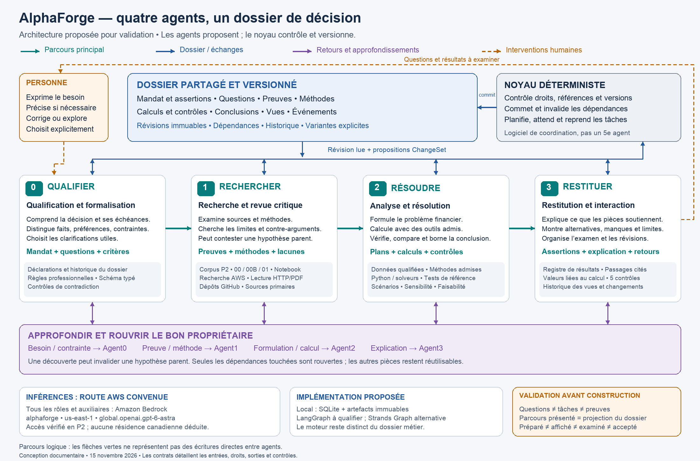
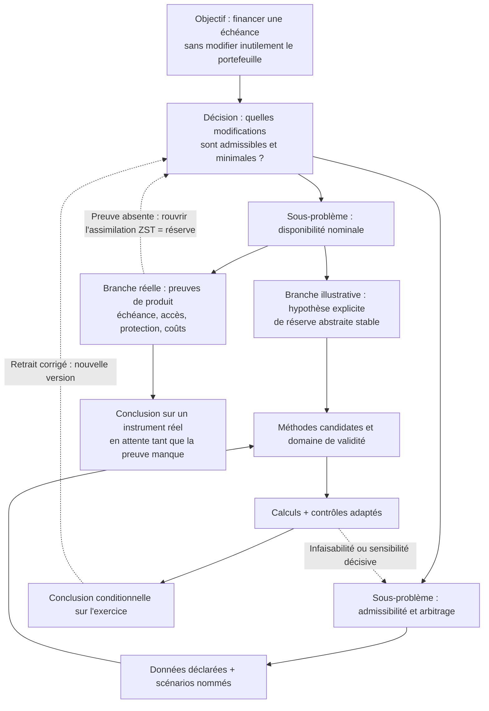

# Fonctionnement cible à valider

**Prompt 3 · 15 novembre 2026 · Proposition de conception, non construite.**

La proposition conserve les quatre responsabilités établies : **qualifier la décision, rechercher ses fondements, résoudre le problème, restituer et organiser sa révision**. Chacune transforme des pièces identifiées d’un dossier commun. Le dossier fait autorité ; les conversations, les traces d’exécution et les textes affichés lui sont rattachés.

Le fonctionnement est volontairement plus large qu’un allocateur : définition documentée, comparaison, financement d’une échéance, concentration, exclusions, faisabilité ou allocation peuvent nécessiter des travaux différents. Robert est un exemple de validation, pas le périmètre du produit.

[Schéma de l’architecture proposée](architecture.png) · [Version vectorielle](architecture.svg) · [Contrats détaillés](02_contrats_echanges.md) · [Comparaison technique](03_decisions_techniques.md) · [Parcours et contrôles](04_parcours_et_controles.md) · [Exemple financier](05_exemple_financier.md) · [Dossier JSON illustratif](exemples/robert_dossier.json).

## 1. Architecture proposée

Le parcours principal va d’Agent0 à Agent3. Ce chemin n’impose ni quatre appels uniques ni quatre étapes répétées à chaque message. Une recherche peut ouvrir plusieurs sous-questions ; un calcul peut contester une hypothèse ; une demande d’explication peut réutiliser l’analyse sans la recalculer.

Les flèches vertes indiquent la progression logique. Les pièces échangées passent par le dossier et les écritures par son noyau, plutôt que par une conversation libre faisant autorité entre agents.

| Composant | Transformation ou responsabilité |
|---|---|
| **Agent0 — Qualification et formalisation** | Demande et déclarations → mandat, préférences/contraintes distinguées, questions et critères de résolution. |
| **Agent1 — Recherche et revue critique** | Questions → sources réellement examinées, preuves qualifiées, contre-arguments, méthodes candidates et lacunes. |
| **Agent2 — Analyse et résolution** | Mandat, preuves, méthodes et données → problème explicite, calculs, validations, alternatives et conclusions conditionnelles. |
| **Agent3 — Restitution et interaction** | Pièces suffisamment contrôlées → assertions traçables, explication proportionnée, examen des options et demandes de révision. |
| **Noyau du dossier et ordonnanceur** | Logiciel déterministe : autorise les écritures, vérifie versions et références, commet les changements, invalide les dépendances et planifie les tâches prêtes. Ce n’est pas un cinquième agent financier. |
| **Adaptateurs d’outils** | Recherche, lecture, calcul et vérification avec entrées/sorties structurées, erreurs et reçus techniques. Les réponses d’outils ne deviennent pas automatiquement des preuves. |
| **Dépôt versionné** | Révisions, objets, relations, événements et artefacts immuables. Il permet de retrouver la question exacte à laquelle une ancienne conclusion répondait. |

Les quatre rôles peuvent utiliser le même modèle AWS. Leur distinction se mesure par leurs décisions autorisées, leurs outils, leurs écritures et leurs conditions de passage. Aucun rôle ne peut réécrire les pièces d’un autre pour masquer un désaccord.

### Ressources mobilisées

- **Inférence** : route convenue Amazon Bedrock, profil AWS `alphaforge`, entrée `us-east-1`, modèle `global.openai.gpt-6-astra`. Cette route s’applique également aux sous-travaux et éventuels modèles auxiliaires. Le profil global ne prouve pas une résidence canadienne.
- **Qualification et preuves** : documents 00, 00B, 01 et notebook déjà examinés ; corpus critique du Prompt 2 ; déclarations du dossier ; textes professionnels et primaires qualifiés.
- **Recherche** : `InvokeWebSearch` déjà testé sur AWS ; récupération HTTP/PDF et accès GitHub documentés dans l’inventaire. Les adaptateurs exacts du futur produit restent à intégrer. Un connecteur disponible dans l’environnement de travail n’est pas automatiquement accessible à l’application.
- **Analyse** : données locales qualifiées, méthodes publiées et implémentations inspectées ; noyau Python existant comme matériau réutilisable, avec vérification de son adéquation au nouveau mandat. Les nouvelles méthodes restent admissibles après évaluation.
- **Restitution** : registre des résultats, passages cités, contrôles indépendamment documentés et gabarits de valeurs. Agent3 ne dispose pas d’un raccourci permettant d’inventer une nouvelle allocation.

La [note technique](03_decisions_techniques.md) distingue accès réellement exercés, code/documentation inspectés et intégrations encore à construire. Les [preuves de route](../recherche/aws_agentique/01_preuves_aws_et_recherche.md) restent celles du Prompt 2 ; aucun nouvel appel produit n’est revendiqué ici.

## 2. Le dossier : ce qui change, ce qui reste

Une révision est une vue cohérente des versions de pièces acceptées. Les pièces anciennes ne sont pas modifiées en place. Un événement indique qui a proposé un changement, sur quelles entrées et avec quel motif ; le noyau conserve sa décision d’acceptation, de rejet ou de conflit.

| Identité | Rôle |
|---|---|
| `dossier_id`, `branch_id`, `revision` | Dossier, variante et état cohérent à un instant du travail. |
| `artifact_id`, `version`, empreinte | Pièce logique, version immutable et contrôle de son contenu. |
| `task_id`, `attempt_id` | Travail attendu et tentative technique ; un retry n’est pas une nouvelle opinion. |
| `view_id`, événement d’affichage | Paquet de restitution fondé sur une révision précise, puis événement distinct attestant sa présentation effective. Préparer une vue ne signifie pas l’avoir affichée. |
| Événement d’examen ou de choix | Ce que la personne a explicitement examiné ou choisi, avec objet, version et portée. |
| Checkpoint du moteur | Point de reprise technique ; il ne remplace aucune des identités métier précédentes. |

Le dossier comporte le mandat et les assertions, le graphe des questions, les pièces documentaires, les méthodes et plans d’analyse, les données et calculs, les contrôles, les conclusions, les paquets de restitution, les tâches et le journal des changements. Un stockage relationnel peut porter ces objets et leurs liens ; une base spécialisée de graphes n’est pas nécessaire à ce stade.

**Exemple de distinction essentielle :** un calcul à 30 000 CAD peut demeurer mathématiquement correct pour ses entrées tout en étant périmé pour le mandat actif à 40 000 CAD. Son statut historique et son utilisabilité courante sont deux champs distincts.

## 3. Quatre représentations liées

| Représentation | Contenu | Exemple Robert |
|---|---|---|
| **Graphe des questions** | Ce qu’il faut établir, pourquoi, par qui, avec quels critères de résolution et de réouverture. | Le retrait exige-t-il une réserve nominale ? La modification minimale est-elle atteinte ? |
| **Graphe des tâches** | Ce qui doit être exécuté : rôle, entrées versionnées, dépendances, tentative, budget, statut et motif d’attente. | Lire une condition de produit ; résoudre le LP ; vérifier sa borne ; préparer une restitution. |
| **Graphe des preuves** | Ce qui soutient, réfute ou limite une assertion : passages, données, calculs, hypothèses et contrôles. | La borne algébrique soutient le minimum conditionnel ; l’absence de document limite la conclusion sur la réserve réelle. |
| **Parcours présenté** | Projection des besoins, résultats et attentes utiles à la personne. Ce n’est pas une quatrième base de vérité. | « Le retrait a changé ; l’ancienne réserve est insuffisante ; l’analyse est en cours de révision. » |

Un travail terminé n’est pas une question résolue. Une référence collectée n’est pas un appui suffisant. Un accord entre quatre agents ne constitue pas une vérification indépendante. Une ancienne vue ouverte ou exportée ne vaut pas acceptation de la nouvelle.

## 4. Résolution récursive

Le graphe suit la chaîne demandée, avec des embranchements et des pièces partagées :

### Contrat de chaque nœud

Tout nœud porte un identifiant/version, une question explicite, son type, son propriétaire, ses parents, ses dépendances versionnées, sa portée et son état. Il définit :

1. **Ce qui le résoudrait** : critère observable, pièces exigées et qualité minimale de contrôle.
2. **Ce qui manque** : données, sens, preuve, méthode admise ou résultat ; effet sur la conclusion.
3. **Ce qui le rouvrirait** : changements d’entrées, réfutation d’hypothèse, correction de méthode, expiration pertinente ou nouvelle demande.
4. **Ce qu’il peut partager** : pièces réutilisables et conditions d’applicabilité.

Types : `objective`, `decision`, `subproblem`, `data_requirement`, `evidence_requirement`, `method_choice`, `calculation`, `verification`, `conclusion`. États de question : `open`, `ready`, `working`, `waiting`, `resolved`, `resolved_conditionally`, `reopened`, `unresolved_in_scope`, `superseded`. Une attente indique son motif ; `unresolved_in_scope` peut clore une recherche bornée sans convertir l’inconnu en résultat.

| Nœud de l’exemple | Ce qui le résoudrait | Dépendances | Réouverture justifiée par |
|---|---|---|---|
| O — Objectif | Décision traitée dans son périmètre ; limites et choix non résolus clairement rendus. | Mandat, conclusions. | Nouvelle échéance, objectif différent, hypothèse parent réfutée. |
| D — Décision | Options admissibles et critère d’arbitrage explicite ; aucun choix unique fabriqué. | Besoin, disponibilité, contraintes, analyse. | Changement de montant, de base du plafond TSLA ou de critère. |
| Q1 — Disponibilité nominale | Conditions d’un instrument actuel établies ; **ou** portée abstraite explicitement limitée pour le seul exercice. | Échéance/montant, documents, hypothèse de réserve. | Document contraire, frais/protection sensibles au montant, réserve extérieure nouvelle. |
| Q2 — Admissibilité | Budget, réserve, plafond et pertes de scénarios contrôlés sur valeurs brutes. | Positions, contraintes, scénarios. | Changement d’une de ces entrées ; erreur du calcul. |
| F — Paramètres | Valeurs nécessaires, unités, origine et date/scope ; inconnus non substitués. | Déclarations et exemple P1. | Correction de déclaration, nouvelle transaction ou nouvelle convention de devise. |
| P — Preuve de réserve | Document primaire applicable, passage lu, conditions et limites vérifiées. | Instrument identifié, date et montant. | Source amendée ; identification erronée ; contradiction non résolue. |
| M — Méthode | Formulation justifiée pour la question, implémentation admise et domaine de validité explicite. | Objectif de rotation, paramètres, hypothèses. | Ajout de coûts, horizon dynamique, objectif secondaire ou manque d’outil. |
| C — Calcul | Entrées figées, résultat reproductible, résidus et contrôle indépendant suffisant. | Méthode et paramètres versionnés. | Entrée/méthode corrigée ; réponse d’outil incomplète ; contrôle en échec. |
| V — Vérification | Contrôles attribués et suffisants pour les assertions visées ; mécanisme et limites explicites. | C, mandat, passages et hypothèses. | Contrôle corrigé, autre portée demandée ou nouveau défaut détecté. |
| K — Conclusion | Assertions liées aux pièces et cinq contrôles suffisants pour la portée annoncée. | C, P, hypothèses, alternatives et inconnues. | Toute dépendance matérielle modifiée ou limite décisive omise. |

Dans Robert, P reste non résolu. Le calcul abstrait peut résoudre conditionnellement une branche ; il ne résout pas la question d’un instrument réel. Cette différence doit remonter jusqu’au parent.

### Comment une découverte remonte

Agent1 constate qu’aucune pièce disponible ne démontre « ZST assure le nominal du retrait ». Il produit une lacune reliée à cette hypothèse, pas la déclaration inverse « ZST perdra le nominal ». Le noyau rouvre la branche de disponibilité et les conclusions dépendantes. Agent0 reformule le périmètre ; Agent2 distingue une réserve abstraite de l’instrument non qualifié. La recherche sur les conditions réelles peut continuer sans empêcher l’exercice explicitement conditionnel.

Une réouverture n’a pas besoin de parcourir tous les agents dans l’ordre. Elle cible le propriétaire du problème : besoin → Agent0 ; preuve/méthode publiée → Agent1 ; formulation/calcul → Agent2 ; formulation de l’explication → Agent3. Tout rôle peut signaler une anomalie ; seul le propriétaire compétent propose la pièce corrigée.

### Partage, arrêt et bornes

Deux branches peuvent utiliser une même capture de source, une même définition ou une même matrice de covariance. La réutilisation exige l’identité des versions et l’adéquation de la portée. Modifier un retrait ne change pas nécessairement une covariance ; modifier devise, période ou univers la change.

Les dépendances nécessaires à un calcul accepté sont acycliques. Les retours métier créent de nouvelles versions et tâches ; les liens de réfutation entre assertions ne sont pas des dépendances d’exécution.

La recherche s’arrête quand les critères utiles à la question sont satisfaits, ou quand le dossier peut rendre honnêtement une réponse partielle/indécidable. Budget ou temps épuisé produit une limite attribuée, jamais une résolution par défaut. Une attente humaine n’occupe pas un worker et ne se termine pas par une approbation implicite.

## 5. Exemple de versions et d’échanges

Le [JSON rempli](exemples/robert_dossier.json) reconstitue un dossier à partir de résultats P1/P2 réellement exécutés. **Les événements d’agents et de présentation sont des exemples de conception**, pas des traces de cette application.

| Révision illustrative | Transformation identifiable | Effet |
|---|---|---|
| r1 | Agent0 qualifie le retrait de 30 000 CAD et le critère de capital déplacé. | Mandat et questions, sans allocation inventée. |
| r2 | Agent1 signale l’absence de preuve de réserve et documente les méthodes. | Hypothèse parent contestée ; branche sur instrument réel en attente. |
| r3 | Agent0 délimite l’exercice avec réserve abstraite. | Calcul conditionnel autorisé dans le scénario fictif, sans valider un produit. |
| r4 | Agent2 produit analyse et contrôles à 30 000 CAD. | Plusieurs optima ; minimum de 30 000 CAD déplacés sous les hypothèses. |
| r5 | Agent3 prépare la restitution limitée. | Chiffres liés aux calculs ; réserve réelle et départage toujours ouverts. |
| r6 | Correction fictive explicite : retrait de 40 000 CAD ; Agent0 révise. | Ancienne admissibilité périmée pour le mandat actif ; pièces indépendantes conservées. |
| r7 | Agent2 produit l’analyse à 40 000 CAD. | Minimum de 40 000 CAD déplacés depuis le même portefeuille initial. |
| r8 | Agent3 prépare la nouvelle restitution. | Comparaison des deux plans, aucune acceptation humaine fabriquée. |

Un calcul r4 arrivé après r6 ne peut pas rétablir la réponse à 30 000 CAD. S’il échoue à 40 000 CAD, le système conserve le mandat corrigé et un résultat en attente. « Et si 40 000 ? » aurait créé une variante, pas remplacé le mandat principal.

## 6. Préserver les distinctions jusque dans l’explication

| Distinction | Règle de dossier et de sortie |
|---|---|
| Déclaré / extrait / supposé / inconnu | Origine séparée de la vérification ; extrait exige un passage ; inconnu n’a pas de valeur de remplacement silencieuse. |
| Préférence / contrainte | Désir d’arbitrage séparé d’une condition d’admissibilité ; passage à une contrainte fondé sur une déclaration explicite. |
| Historique / scénario | Date et données observées séparées des chocs/hypothèses ; aucune probabilité inventée pour un scénario. |
| Résultat / commentaire | Valeurs dans un registre calculé ; prose reliée aux valeurs, sans nouveau nombre de décision généré librement. |
| Garantie conditionnelle / résultat empirique | Théorème avec hypothèses ; observation avec protocole, échantillon et limites. Ni l’un ni l’autre ne vaut garantie contractuelle d’un produit. |
| Consensus / contrôle indépendant | Accord de rôles enregistré comme accord ; contrôle décrit son mécanisme, ses entrées, sa portée et son indépendance. |

Agent3 ne peut pas rendre « conseillé » ce qui est seulement « faisable sous deux chocs », ni « compris » ce qui a seulement été affiché. Les [cinq contrôles](04_parcours_et_controles.md) portent séparément sur fidélité, exactitude, adéquation, ancrage et validité externe. Leur état s’applique à chaque assertion : une phrase partielle peut être utile même si une autre reste bloquée.

## 7. Décisions proposées et validation attendue

### Fonctionnement soumis à validation avant construction

La validation porte sur cet ensemble : quatre transformations distinctes ; dossier versionné faisant autorité ; questions et preuves récursives ; retours ciblés ; inconnus explicites ; calculs via outils admis ; restitution proportionnée ; corrections sans confirmation redondante ; choix humain requis lorsque le sens ou une contrainte doit réellement changer.

**Aucun changement de direction n’est proposé par rapport au cadre précédent.** Le registre des méthodes reste extensible : Agent1 peut découvrir une méthode, Agent2 en proposer l’évaluation, puis une implémentation peut être admise après les contrôles appropriés. Il ne s’agit pas de limiter les demandes aux quelques fonctions du prototype actuel.

### Choix techniques que le responsable peut prendre après validation

Le [comparatif](03_decisions_techniques.md) propose un dossier indépendant du moteur, SQLite et fichiers immuables pour l’usage local, puis **LangGraph en premier candidat à qualifier**, Strands Graph comme alternative et machine à états explicite comme référence de simplicité. Schéma de tables, versions compatibles, index, adaptateurs, limites d’exécution et mécanismes de reprise relèvent de l’exécution technique de ce contrat.

Un mini-parcours de qualification devra tester concurrence, correction pendant calcul, panne entre commit/checkpoint, reprise et preuve manquante. Le choix final du moteur suivra ces résultats ; aucun framework n’est présenté comme déjà intégré ou validé.

### Changements qui demanderaient un nouvel accord

Fusionner un rôle, figer la décision dans un questionnaire/allocateur unique, supprimer provenance ou révision, modifier la route d’inférence, déplacer l’usage local vers un service partagé, changer l’audience ou ajouter une dépendance payante hors cadre modifierait le fonctionnement convenu. Un obstacle technique ne permet pas de décider silencieusement ces changements.

**La construction attend la validation demandée dans le Prompt 3.** Les scénarios de réception décrivent des tests futurs ; leur rédaction et le contrôle de cohérence de ces documents ne signifient pas qu’ils ont été exécutés sur le produit.

## 8. Fondements réutilisés

Cette conception traduit les [conclusions du Prompt 2](../recherche/01_synthese_et_fonctionnement_cible.md), les [fonctions et fondements d’Agent1](../recherche/methode_sources/01_fondements_et_agent1.md), les [contrats financiers](../recherche/finance/02_fiche_agent2.md) et les [contrats d’orchestration](../recherche/aws_agentique/02_orchestration_critique_et_contrats.md).

Les textes professionnels justifient l’examen du besoin et des contraintes ; ils ne prescrivent pas ces quatre processus logiciels. Les travaux sur les agents motivent outils contrôlés, révision et évaluation ; ils ne prouvent pas la supériorité de cette architecture particulière. Le dossier, les droits d’écriture et les règles d’invalidation sont des **choix de conception à tester**.
