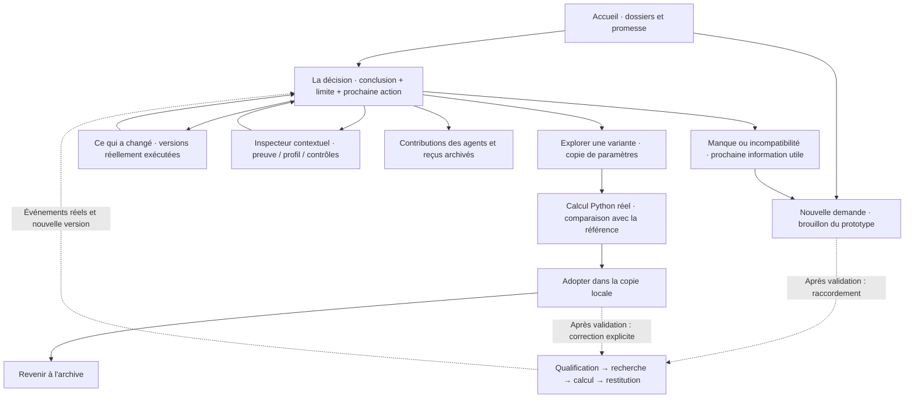

# Canvas AlphaForge — le carnet de décision vivant

**À essayer : [prototype local](http://127.0.0.1:8770/)** —
[Robert](http://127.0.0.1:8770/#dossier/robert/r5/decision),
[Amira](http://127.0.0.1:8770/#dossier/amira/r5/decision),
[révisions de Robert](http://127.0.0.1:8770/#dossier/robert/r5/history).

Version de conception **0.1 — proposée, non validée**. Le produit existant
sur [8768](http://127.0.0.1:8768/) conserve ses dossiers et ses sessions.
La validation attendue concerne la direction visuelle et les interactions
majeures. L'intégration dans ce produit viendra après ce retour.

Documents associés : [recherche et directions](recherche.md),
[matrice d'adaptation](matrice_adaptation.md),
[paramètres et annulation](parametres.md),
[dossier de défense](../defense/README.md).

## 1. Promesse et tâches

**Comprendre pourquoi une conclusion tient, explorer ce qui la ferait
changer et retrouver les preuves qui permettent de la contester.**

AlphaForge est ici un atelier de décisions financières fictives. Un calcul
exact sous ses hypothèses n'est ni un placement garanti ni une démonstration
de la supériorité d'une équipe d'agents.

L'utilisateur doit pouvoir :

- partir d'une demande et distinguer ce qui a été compris de ce qui manque ;
- comprendre la réponse et sa limite principale sans lire tout le dossier ;
- comparer les conséquences de plusieurs options dans les mêmes unités ;
- vérifier un chiffre ou une hypothèse en conservant la décision à l'écran ;
- explorer une autre valeur sans remplacer son dossier de référence ;
- corriger une information, comprendre les dépendances et revenir à l'état
  qu'il consultait ;
- approfondir méthode et sources sans changer les résultats.

Le succès se juge par ces tâches, pas par le nombre de cartes, d'agents
affichés ou de secondes d'animation.

## 2. Ce que nous conservons et ce que nous ajoutons

| Classe | Capacité | Traitement proposé |
|---|---|---|
| **Opérationnelle dans le produit** | Quatre contributions distinctes, dossier versionné, artefacts immuables, calculs de réserve et comparaison historique, corrections Robert, manques, certificat budgétaire, reçus AWS. | Conserver les moteurs, contrats et états ; présenter leurs résultats avec une nouvelle hiérarchie. Les acquis et limites sont décrits dans la défense. |
| **Présente mais à rendre plus perceptible** | Minimum non unique, référence simple aussi efficace sur Robert r5, portée des cinq contrôles, origine des faits, réutilisation des pièces, source sélectionnée distincte de source consultée. | Remonter les limites déterminantes dans la décision ; accès contextuel à la preuve et comparaison des versions ; activité des agents facultative. |
| **Interaction nouvelle avec adaptation technique** | Atelier visuel de variantes, adoption distincte d'une correction, panneau de preuve contextuel, affichage adaptatif, export des valeurs du graphique. | Prototype isolé d'abord. Après validation : raccordement aux commandes et événements réels, identifiants de branche/version, reçus de calcul, contrôle des changements concurrents. |
| **Exploratoire** | Élicitation adaptative par valeur de l'information, contrefactuels généraux, édition des chocs, variantes d'Amira dans cette nouvelle UI, traduction, personnalisation du vocabulaire, qualité de décision mesurée. | Ne pas présenter ces idées comme opérationnelles. Aucun curseur de confiance, projection probabiliste ou score ESG ajouté à la maquette. |

### Périmètre exact du prototype

Le prototype ouvre **six états archivés** : Robert r5/r10/r15, Amira r5,
demande incomplète r4 et retrait impossible r5. Leurs chiffres, preuves,
faits et événements proviennent des exports du système.

L'atelier de Robert appelle réellement le moteur Python existant sur une
**copie** des entrées. Il produit un résultat et un reçu locaux ; il ne
relance aucun agent et ne crée aucune révision dans SQLite. Les indications
de réexamen y sont étiquetées comme des **dépendances prévues**, distinctes
des événements archivés. « Utiliser dans la copie du prototype » reste une
adoption locale et réversible, pas une modification du dossier officiel.

Une nouvelle demande libre et les clarifications sont conservées comme
brouillons de navigateur, sans extraction simulée. L'erreur volontaire
est un état de démonstration explicitement nommé. L'attente de calcul,
elle, correspond à une vraie requête au moteur.

## 3. Architecture de l'information et navigation

L'objet principal est **la décision dans son dossier et sa version**.
La navigation ne reproduit pas l'organigramme des agents.

**Trois niveaux de lecture**, facultatifs et réversibles, se trouvent dans
le même dossier : **L'essentiel**, **Les options**, **La méthode**.
Ils ne constituent pas un score de compétence. Le choix n'est jamais
déduit de l'âge, du patrimoine ou de l'appétit pour le risque.

**Trois espaces de travail** répondent à trois intentions : « La décision »,
« Explorer une variante » et « Ce qui a changé ». Le repère dossier/version
reste présent. Un retour aux dossiers est toujours visible.

Le panneau contextuel accueille profil, preuve, sources, limites, contrôles
ou travail des agents. Il restitue le focus au point d'entrée. Une recherche
filtre les sources et passages ; une recherche globale n'est pas justifiée
par les quatre dossiers de référence actuels.

## 4. Carte des vues et contrats d'expérience

| Vue | Question de l'utilisateur | Information nécessaire | Action possible | Résultat attendu | Données requises / état |
|---|---|---|---|---|---|
| **Accueil** | Que puis-je comprendre ici ? | Promesse, deux familles de décision, exemple de révision, limites d'usage. | Ouvrir Robert/Amira, un cas limite ou une demande libre. | Un point de départ intelligible sans remplir un long formulaire. | Index des cas, types, capital, fenêtre et versions archivés ; nouvelle demande = brouillon. |
| **Décision Robert** | Quel est le minimum à déplacer, et que signifie-t-il ? | Minimum CAD, retrait, contraintes, réserve abstraite, non-unicité, référence simple lorsque disponible. | Pourquoi ce chiffre ? Comparer ; explorer ; corriger. | Comprendre le résultat et ce qu'il ne prouve pas. | `stats`, `claims`, `analysis.options`, `optimal_face`, `simple_reference`, `problem`, limites. |
| **Comparaison Robert** | Les options équivalentes sur le minimum ont-elles les mêmes pertes ? | Poids, capital déplacé, pertes des deux chocs, admissibilité. | Passer répartition/tableau ; ouvrir hypothèses et contrôle. | Comparer à données et unités constantes, sans gagnant fabriqué. | Options et chocs du même état ; règle simple indépendante r5 seulement. |
| **Décision Amira** | Qu'aurait changé une exposition TSLA plus faible ? | Deux trajectoires CAD, dates, rendement cumulé, baisse maximale, politique de redistribution. | Lire les données exactes, exporter CSV, approfondir. | Comprendre une comparaison passée, sans la transformer en prévision. | Séries et métriques réelles, même grille/date/change ; snapshot acquis en novembre 2026. |
| **Profil et origine** | Quels faits ont réellement servi ? | Valeur, origine déclarée/extraite/supposée/inconnue, demande source, référence/version. | Lire les origines puis préparer une correction. | Distinguer un fait humain, une hypothèse et une lacune. | `facts`, `problem`, `request`, références de provenance. L'absence de provenance n'est pas présentée comme « déclarée ». |
| **Variante Robert** | Que change cette hypothèse sans toucher à mon dossier ? | Valeurs de référence, champs éditables et effets attendus, portée du calcul. | Modifier retrait/perte, puis capital/plafond TSLA ; calculer ; comparer ; annuler. | Résultat calculé sur copie, limites inchangées de nature, reçu inspectable. | `POST /api/prototype/explore` ; moteur réel ; aucun état produit muté. |
| **Adoption locale** | Puis-je lire cette variante comme mon nouvel état d'essai ? | Différences, absence de nouvelle revue agentique, référence d'origine. | Utiliser la copie ; revenir à l'archive. | Nouvelle lecture locale avec bandeau de portée ; original intact. | Résultat local en mémoire de l'interface, pas une branche durable du dossier. |
| **Révisions exécutées** | Pourquoi la réponse a-t-elle changé ? | Avant/après, paramètre corrigé, pièces réutilisées et dépendantes, événements. | Ouvrir r5/r10/r15 ; lire les événements source. | Relier 30→40→74,4 kCAD à deux corrections distinctes. | Exports et événements réels ; chaque état part du même portefeuille initial. |
| **Preuve contextuelle** | D'où vient cette affirmation ? | Affirmation, valeur liée, méthode, paramètres, contrôle, empreinte et portée. | Examiner le lien exact, contrôles séparés, documents. | Une raison vérifiable sans perdre la conclusion. | `claims`, `proofs`, liaisons/pointeurs, hash de l'artefact, reçu du calcul. |
| **Sources et limites** | Qu'appuie réellement cette publication ? | Passage capturé, profondeur de lecture, date, sélection, contradiction et limite. | Rechercher, lire, ouvrir l'original. | Ne pas confondre présence d'une citation et implication logique de la conclusion. | Preuves documentaires et revue A1 archivées, distinctes des contrôles postérieurs. |
| **Travail accompli** | Que chaque agent a-t-il ajouté ? | Mission, tâches, entrées, sorties, état, reçus AWS. | Ouvrir transformations et reçus. | Voir des contributions effectives, pas une animation de débat. | `agents`, tâches/tentatives/événements archivés. Une copie locale indique zéro nouvelle revue. |
| **Demande incomplète** | Pourquoi ne puis-je pas encore obtenir de montant ? | Douze mois compris ; capital/retrait/positions et autres manques. | Préparer les informations, consulter les points manquants. | Une attente expliquée ; aucune allocation inventée. | Questions de la qualification ; brouillon seulement dans le prototype. |
| **Impossibilité** | Quelle contrainte empêche de poursuivre ? | Retrait 120 kCAD, capital 100 kCAD, écart 20 kCAD, hypothèses du certificat. | Lire le certificat ; préparer une modification. | Un diagnostic utile sans relaxation automatique. | Résultat `reserve_budget_infeasible` ; aucun portefeuille de remplacement. |
| **Chargement / erreur / reprise** | Mon travail est-il perdu ? | Opération en cours ou échec identifié, paramètres conservés, original intact. | Réessayer avec les mêmes paramètres ; annuler l'essai. | Reprise compréhensible sans faux pourcentage ni double adoption. | Requête réelle de calcul ; erreur d'essai explicitement simulée ; aucun appel AWS ajouté. |

## 5. Adaptation : contenu financier et présentation

Le [contrat d'adaptation](matrice_adaptation.md) conserve un noyau invariant :
identité/version, nombres, unités, période, origine, conditions déterminantes,
inconnus et portée. L'essentiel priorise une réponse ; les options montrent
les différences ; la méthode explique comment les résultats ont été produits.

Le profil financier comprend objectif, capital, positions, liquidité,
échéance, contraintes, préférences et hypothèses. Certains champs n'ont pas
d'effet numérique dans une méthode donnée : l'horizon de quinze ans
d'Amira n'allonge pas les cinq ans d'observations. Le système doit l'expliquer
plutôt que donner l'impression qu'un réglage agit.

Le prototype expose le niveau de lecture, le passage répartition/tableau
et la recherche documentaire. Il ne propose pas encore de sélecteur de
langue, de vocabulaire personnalisé, de banque de définitions à la demande
ou de profil d'accessibilité enregistré. Le navigateur conserve ses
possibilités de zoom ; la feuille de style prévoit une réduction des
mouvements.

## 6. Système visuel réutilisable

Les tokens sont centralisés dans
[`prototype/prompt6/style.css`](../../prototype/prompt6/style.css).
Les polices sont locales ; aucune requête à un service de police n'est
nécessaire à l'ouverture.

| Élément | Proposition | Fonction |
|---|---|---|
| Typographie | **DM Sans** pour interface et chiffres ; **Newsreader** pour les accents éditoriaux et questions. Replis Arial/Georgia. | Distinguer lecture et manipulation sans changer de langage visuel. Chiffres tabulaires dans les tableaux. |
| Texte / fond | Encre `#182f45`, texte secondaire `#526676`, papier `#f7f7f2`, surfaces blanches. | Hiérarchie sobre et longues lectures. Les contrastes font l'objet d'un contrôle ciblé, pas d'une certification déclarative. |
| Actions et détails | Bleu `#174f79`, fond `#e9f0f6`. | Repérer l'action et les éléments examinables. |
| Conditions et erreurs | Brun `#a54b27` / fond chaud `#fbefe5` ; erreur `#a43835`. | Distinguer une limite d'une panne. Les libellés portent le sens même sans couleur. |
| Réutilisation | Vert `#236858` / fond `#edf5f1`. | Dire « conservé » ou « exécuté » dans une portée donnée ; jamais « investissement sûr ». |
| Densité | Colonne de décision large, contexte latéral court ; espacement par groupes de tâches ; détails dans un inspecteur. | Éviter une grille uniforme de cartes techniques ; faciliter la lecture et la comparaison. |
| Graphiques | Poids empilés avec tableau équivalent ; comparaison des pertes par choc ; deux courbes historiques avec styles de traits distincts. | Représenter uniquement les données disponibles. Pas de jauge de confiance ni de projection décorative. |
| Mouvement | Transitions brèves de survol ; indicateur indéterminé pendant une vraie requête ; réduction via `prefers-reduced-motion`. | Signaler un changement sans simuler l'activité intellectuelle des agents. |
| Ton | « Dans ce modèle », « archive », « copie », « hypothèse », « manque ». | Expliquer la portée dans des mots simples, sans empiler du jargon ou promettre une certitude. |

Composants réutilisables : repère dossier/version, sélecteur de profondeur,
nombre lié à une preuve, bandeau de limite, comparaison d'options,
champ avec origine/unité/aide, résultat de variante, différence de versions,
état vide utile, message d'erreur avec reprise, panneau de preuve, liste de
sources filtrable et reçu d'exécution.

## 7. Interactions et états à préserver

**Lire → vérifier → revenir.** Le chiffre important a une action explicite.
Le panneau répète l'affirmation examinée et montre son lien au calcul. La
fermeture revient au même endroit. Les clés techniques restent dans un
détail inspectable.

**Explorer → comparer → adopter ou écarter.** Le formulaire annonce sa
référence. Le calcul ne remplace pas cette référence. L'adoption dans le
prototype change seulement la copie locale. Après validation, une adoption
dans le produit devra porter une commande explicite de correction ou de
création de branche, avec références de base et contrôle de concurrence.

**Corriger → invalider → réexaminer.** Dans les archives de Robert, ce chemin
est observable avec de vrais événements. Dans une nouvelle variante locale,
l'interface montre les dépendances prévues et le calcul exécuté ; elle ne
prétend pas que recherche et restitution ont été relancées.

**Annuler et revenir.** Annuler une saisie restitue les champs de référence ;
écarter un résultat conserve le dossier ; revenir à l'archive abandonne la
copie affichée. Aucun de ces gestes ne supprime un événement historique.
La conservation durable de branches et leur restauration ne sont pas
implémentées dans le prototype.

**Répondre à un manque.** Le montant du retrait explique le besoin de réserve,
mais sa réponse seule ne remplit pas capital et positions inconnus. Le
prototype conserve le brouillon ; le futur raccordement devra créer un
événement humain et reprendre la qualification.

**Récupérer une erreur.** Le message distingue entrée inadmissible, erreur
simulée et échec effectif du calcul. Les champs sont conservés, la reprise
réutilise ces paramètres, et l'archive demeure accessible. Aucun faux
pourcentage d'avancement n'est affiché.

## 8. Correspondance avec le dossier réel

La projection d'interface est produite par
[`build_data.py`](../../prototype/prompt6/build_data.py). Elle ne transforme
pas un commentaire d'agent en nouvelle preuve.

| Élément affiché | Source actuelle | Invariant / futur raccordement |
|---|---|---|
| Montant minimum, réserve et pertes | `analysis.options[].metrics`, `scenario_results`, `stats.bindings`. | Valeurs et unités liées à la même version ; aucune moyenne de modèles. |
| Affirmation et preuve | `claims`, `proofs`, pointeurs, hash d'analyse. | Un clic ouvre la pièce de l'affirmation actuelle, pas une bibliographie générique. |
| Référence simple | Oracle indépendant conservé pour Robert r5. | Ne pas étendre automatiquement à r10/r15 ou à une variante locale. |
| Poids des allocations | `options[].weights`. | Même ensemble d'options dans tableau et répartition ; total contrôlé dans le moteur. |
| Trajectoire Amira | `options[].series` avec dates et valeurs CAD. | Pas de prolongation après dernière observation ; données exactes exportables. |
| Cadre financier | `problem`, `facts`, `request`. | Distinguer valeur de travail et origine ; le libellé « inconnu » n'est pas une valeur par défaut. |
| Changement exécuté | Versions, `changes`, événements d'archives. | Pièces réutilisées identifiées ; ancienne conclusion gardée avec sa portée historique. |
| Changement envisagé | `dependency_preview` du calcul local. | Statut prévisionnel explicite ; ne pas l'insérer parmi les événements AWS. |
| Travail des agents | Tâches, tentatives, transformations et reçus archivés. | Une vue d'activité ne conclut pas à une utilité marginale démontrée. |
| Statut documentaire | Sources sélectionnées/consultées, limites et contradictions d'A1. | Contexte temporel antérieur au calcul conservé ; appui logique par claim non certifié. |
| Cinq contrôles | `controls` issus de la vue archivée ; contrôles numériques du calcul local séparés. | Fidélité, arithmétique, mandat, appui documentaire et validité externe ne sont pas fusionnés. |
| Nouvelle demande | `sessionStorage` du navigateur dans le prototype. | Après validation : entrée du produit, qualification AWS et affichage des faits extraits. |

## 9. Dépendances des capacités nouvelles

| Capacité | Prototype | Travail après validation |
|---|---|---|
| Nouvelle hiérarchie de lecture | Fonctionne sur exports et calcul local. | Projection du snapshot courant, mêmes composants et mêmes contrôles de version. |
| Variante financière Robert | Calcul déterministe réel ; reçu local. | Identifier et conserver une branche/copie dans le dossier ; distinguer aperçu et adoption. |
| Correction du dossier | Copie locale seulement ; retour à l'archive. | Commande de révision du produit, invalidation atomique, suivi réel des tâches. |
| Qualification depuis phrase libre | Brouillon local ; vrai exemple d'attente consultable. | Raccordement à Agent0, affichage des origines et des questions, état d'erreur AWS. |
| Variante Amira | Lecture de la comparaison exécutée seulement. | Contrat explicite de redistribution et de fenêtre ; rejet des politiques hors domaine. |
| État des quatre agents | Activité archivée inspectable. | Abonnement ou interrogation des événements réels ; pas d'estimation inventée du progrès. |
| Reprise durable | Archives persistantes ; dernier calcul/brouillons de navigateur. | État de navigation distinct du checkpoint métier ; reprise idempotente du produit. |
| Personnalisation plus fine | Trois niveaux ; français fixe. | Valider glossaire/langue/formats et préserver les mêmes claims ; aucune dépendance IA externe non qualifiée. |

## 10. Décisions à valider et décisions techniques réversibles

**Validation demandée à l'utilisateur :** le carnet comme objet principal ;
la hiérarchie éditoriale proposée ; les trois profondeurs ; la preuve dans
un panneau contextuel ; les variantes séparées ; la révision expliquée
avant/après ; l'importance visible des limites et de la référence simple.
Cette validation est demandée par le Prompt 6 avant l'intégration.

**Choix techniques pris dans le cadre autorisé :** prototype local isolé
sur 8770, HTML/CSS/JavaScript modifiables, polices locales, graphiques SVG,
projection des exports, moteur Python existant appelé sur copie, aucun
nouveau modèle ni service payant, conservation du produit sur 8768.
Ces décisions ne modifient pas la promesse du système.

**Conditions de passage à l'intégration :** retour humain sur les tâches
principales ; défauts de compréhension et d'accessibilité examinés ;
correspondance composant→donnée→événement→contrôle établie ; rapprochement
des écrans prototype/produit à même contenu et même taille. Une interaction
validée techniquement impossible devra recevoir un remplacement explicite.

Le prototype peut être jugé maintenant. L'amélioration de la qualité de
décision, le profilage général et la supériorité des quatre agents restent
des questions d'évaluation, pas des résultats acquis par la refonte.
