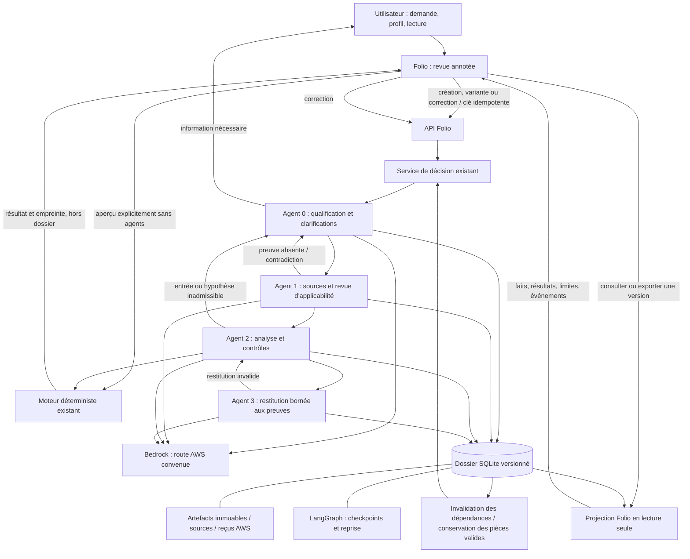

# Architecture réalisée de Folio

L'aperçu local ne traverse pas les quatre agents et ne modifie pas le dossier. Les variantes et corrections traversent la chaîne réelle. Les préférences d'affichage ne quittent pas le contrôleur de présentation. Une version ancienne est une archive, avec sa date et sa portée ; l'historique ne représente pas une suite d'opérations de marché.
