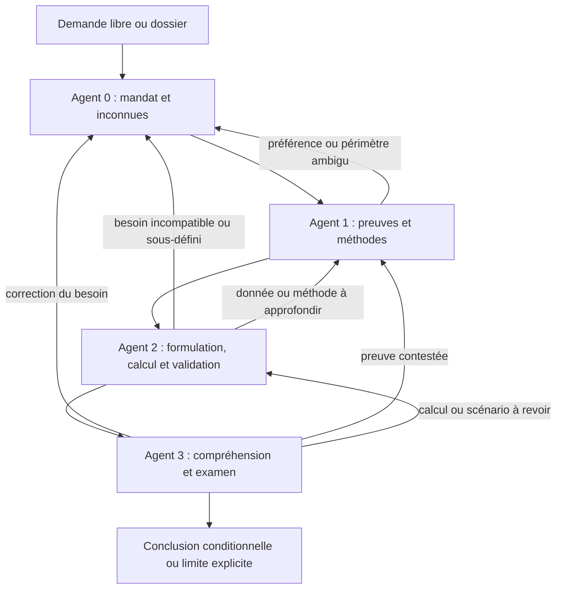

# AlphaForge — Processus professionnels, preuves et fonctionnement cible

**Prompt 2 · Revue du 15 novembre 2026.**

## 1. Recommandation principale

Conserver les **quatre agents distincts** et leur donner des responsabilités que l’on puisse examiner : **Agent 0 qualifie et révise le mandat ; Agent 1 constitue et critique les preuves ; Agent 2 formule, calcule et valide ; Agent 3 fait comprendre, contester et réviser la décision.** Leur intelligence doit se voir dans les décisions qu’ils prennent et les dossiers qu’ils se transmettent.

Le fonctionnement cible est un **processus itératif de décision sous contraintes et information imparfaite**. Il commence par le besoin à résoudre, peut revenir sur sa formulation, compare des options admissibles et produit une conclusion conditionnelle. Les calculs stables servent cette souplesse ; ils ne la remplacent pas. Le domaine des méthodes reste ouvert à la recherche, avec une validation explicite avant qu’une nouvelle méthode soit utilisée pour produire un résultat.

Le dossier fourni est très utile comme carte de départ. Plusieurs de ses conclusions doivent toutefois être corrigées : le rendement moyen est difficile à estimer, pas universellement « inestimable » ; 0,85 de Sharpe n’est pas un seuil de significativité universel ; un décalage de publication ne répare pas une série révisée ; OptiGuide génère du code ; un résultat fidèle à un registre peut reproduire une erreur du registre. Les preuves soutiennent une discipline de qualification et de validation, sans imposer une bibliothèque figée, une fusion des rôles ou un allocateur unique.

**Cette étape livre de la recherche, des fiches et des expériences isolées. Elle ne construit aucune nouvelle interface et n’intègre pas les expériences au produit.**

## 2. Périmètre et manière de lire les preuves

Le cadre accepté au Prompt 1 reste la base : les quatre rôles sont conservés. Les anciens documents 00 et 01 autorisaient des fusions ; cette latitude historique ne remplace pas la décision plus récente. La revue exploite :

- les documents **00, 00B et 01**, leur audit du starter, les 36 captures documentaires AWS et leurs liens publics ;
- le notebook d’introduction, lu cellule par cellule et critiqué ;
- le dossier fourni, conservé intégralement dans [00_prompt2_et_dossier_fourni.md](00_prompt2_et_dossier_fourni.md) ;
- des sources complémentaires professionnelles, réglementaires, scientifiques, pédagogiques et techniques ;
- des vérifications d’accès, de code et de calcul réellement exécutées.

L’inventaire comporte **339 URL distinctes dans le dossier fourni** et **505 URL distinctes après ajout des liens des documents et ateliers**. Ce sont des adresses, pas 505 publications indépendantes. Certaines désignent un résumé, une version, un dépôt, une licence ou la même œuvre sur plusieurs sites. Le [registre d’URL](inventaire_urls.json) garde les occurrences dans les documents d’origine ; la [collecte](resultats_collecte.json) enregistre accès, horodatages, empreintes et chemins locaux.

Le [rapprochement des registres](04_verification_livrables.json) couvre les **339 URL du dossier fourni, sans URL omise**. Cette exhaustivité porte sur le triage des références fournies, pas sur la lecture intégrale de 339 documents. Les références bibliographiques sans URL sont traitées séparément ; les liens complémentaires de l’atelier ont aussi leur état d’examen.

La collecte HTTP a reçu 468 réponses 200 sur les 505 adresses, ainsi que des refus, erreurs et autres statuts. **Un HTTP 200 ne signifie pas qu’un article a été obtenu ou lu.** Des pages de cookies et un PDF précédé d’en-têtes parasites ont été repérés. Les registres spécialisés indiquent séparément la lecture réelle, les substitutions par une source primaire et les passages approfondis.

Cette revue est **critique et orientée vers les décisions du projet**. Elle n’est ni une méta-analyse ni une recherche systématique exhaustive de toute la littérature financière. Les références du dossier sont examinées pour leur pertinence et leur niveau de preuve ; seules celles qui influencent les choix sont approfondies. Les études citées dans la bibliographie d’une source ne sont pas automatiquement considérées comme lues.

### Cinq catégories qui ne se remplacent pas

| Catégorie | Ce qu’elle peut soutenir | Ce qu’elle ne prouve pas |
|---|---|---|
| Résultat théorique | Propriété d’une formulation sous hypothèses explicites : convexité, borne, irréductibilité, relation de risque | Que les hypothèses décrivent les marchés ou les préférences du persona |
| Résultat empirique | Effet observé dans un protocole, une population, un univers et une période | Transfert automatique à AlphaForge, causalité hors protocole, supériorité universelle |
| Cadre professionnel ou réglementaire | Informations à recueillir, processus de décision, diligence, communication, responsabilités | Questionnaire calibré, allocation optimale, conformité juridique du prototype |
| Documentation technique et code | Fonctionnement déclaré ou inspecté d’une version précise | Exactitude numérique de tous les chemins, accès effectif du compte, vérité des données |
| Affirmation commerciale ou retour d’expérience | Cas d’usage et hypothèse à tester, possibilités d’intégration | Validation indépendante ni gain applicable à nos demandes |

Le niveau de lecture est une autre dimension : **notice**, **résumé**, **passages analysés**, **texte analysé**, **code inspecté**, **expérience exécutée**. Une expérience réussie ne valide pas tout le dépôt ; une source publiée ne garantit pas la pertinence de son usage.

## 3. Cartographie des fonctions professionnelles

La cartographie est construite à partir du processus de planification de FPSB/FP Canada, du cadre canadien de connaissance du client et de convenance, de la politique de placement et des standards CFA, et des pratiques de validation des modèles. Les travaux sur les agents et l’aide à la décision précisent des mécanismes ; ils ne créent pas à eux seuls un métier financier.

| Fonction établie dans les sources | Question professionnelle | Pièce de travail | Adaptation et responsable |
|---|---|---|---|
| Cadrer la relation et le besoin — FPSB, FP Canada | Quelle décision et quel service sont réellement demandés ? | Mandat, périmètre, attentes et responsabilités | **Agent 0** distingue explication, recherche factuelle, comparaison et modification de portefeuille |
| Recueillir et apprécier la situation — 31-103/IG, 31-368 | Objectifs, capacité, volonté de risque, connaissances, liquidité et horizon sont-ils compatibles ? | Dossier de profil et contradictions | **Agent 0** conserve valeur, provenance, inconnue et version ; aucun profil créé à partir du seul âge |
| Définir une politique de placement — CFA | Quels objectifs et contraintes gouvernent la construction et la gestion ? | IPS, univers admissible, politique de rééquilibrage | **Agents 0 et 2**, avec responsabilité séparée sur le besoin et sa traduction quantitative |
| Effectuer la diligence documentaire — CFA V(A) | Les données et recherches tierces constituent-elles une base raisonnable ? | Notes de recherche, sources, hypothèses, objections | **Agent 1** examine la qualité, l’actualité et la transférabilité |
| Connaître les produits et expositions | Que détient-on, à quel coût, avec quels risques et quelles limites ? | Documents d’émetteur, composition datée, données qualifiées | **Agent 1** établit les faits ; **Agent 2** mesure leurs effets dans le portefeuille |
| Formuler et comparer les solutions | Quelles options satisfont le besoin et quels compromis restent ouverts ? | Modèle de flux, contraintes, scénarios, alternatives | **Agent 2** résout le problème défini et révèle les solutions multiples |
| Examiner les modèles et leurs limites — CFA V(A), E-23, SR 26-2 dans leur champ | Le calcul fonctionne-t-il et est-il approprié à cet usage ? | Fiche de méthode, contrôles, sensibilité et réserve d’usage | **Agent 2**, avec contrôles distincts et contestation possible par les autres rôles |
| Communiquer et examiner avec la personne — FP Canada, CFA V(B) | La conclusion et ses limites sont-elles compréhensibles et contestables ? | Comparaison, explication, facteurs décisifs | **Agent 3** adapte la restitution en conservant les mêmes faits |
| Réviser le plan | Qu’est-ce qui a changé et quelles conclusions deviennent anciennes ? | Nouvelle version du mandat et analyse des dépendances | **Agent 3 → 0**, puis retour ciblé vers **1 et 2** |
| Conserver les justifications — CFA V(C) | Peut-on reconstruire pourquoi une décision, un statu quo ou une abstention a été proposé ? | Sources, paramètres, sorties, échanges, manifeste | Responsabilité de chaque agent sur ses pièces ; conservation commune |

**Portée réglementaire :** les textes canadiens visent les personnes et activités concernées, avec leurs exceptions. Les standards CFA et FP Canada visent leurs membres ou titulaires. Les lignes directrices bancaires ont leur propre champ. AlphaForge en adapte les fonctions de qualité à des demandes fictives ; il ne reçoit pas un statut professionnel ni un certificat de conformité.

En particulier, **SR 26-2 exclut explicitement l’IA générative et agentique** : son apport direct concerne les modèles quantitatifs traditionnels dans son champ bancaire. **E-23 (2027)** est publiée mais n’entre en vigueur que le 1er mai 2027. Leur lecture éclaire notre procédure d’examen sans certifier les agents.

Les fiches détaillées couvrent responsabilités, entrées, documents, sorties, hypothèses, erreurs, évaluation et renvois :

- [Agent 0 — qualification](profil_restitution/03_agent0.md)
- [Agent 1 — recherche et preuves](methode_sources/01_fondements_et_agent1.md)
- [Agent 2 — analyse et validation](finance/02_fiche_agent2.md)
- [Agent 3 — restitution et révision](profil_restitution/04_agent3.md)

Les fondements et passages lus sont détaillés dans les [sources professionnelles et comportementales](profil_restitution/02_sources_decisives.md), les [sources CFA et de méthode documentaire](methode_sources/01_fondements_et_agent1.md), la [revue financière](finance/01_revue_par_decision.md) et la [revue des mécanismes agentiques](aws_agentique/02_orchestration_critique_et_contrats.md).

## 4. Revue par questions et décisions

### Q1. Quel problème résoudre avant de chercher un « bon portefeuille » ?

Les cadres de planification et l’IPS placent les objectifs et contraintes en amont de la sélection d’actifs. Dans le cas Robert du Prompt 1, la question est de financer un retrait tout en limitant les changements et certaines expositions. Une réduction de TSLA peut améliorer un risque historique sans satisfaire le besoin de liquidité.

**Décision :** l’Agent 0 formule d’abord l’unité de décision et les contraintes réellement exprimées. L’Agent 2 examine la faisabilité et les options avant tout classement. « Ne rien changer », ajustement minimal et autre solution admissible sont des comparateurs utiles ; une option incompatible reste montrable comme contre-exemple, avec son échec explicite.

**Ce qui reste ouvert :** les instruments réels permettant d’assurer une réserve à l’échéance, leurs frais et conditions. Une réserve nominale abstraite à rendement nul dans une expérience n’est ni un FNB obligataire ni une garantie commerciale.

### Q2. Le profil peut-il se réduire au minimum de deux scores ?

Les textes canadiens distinguent volonté et capacité de prendre du risque. L’avis 31-368 critique les profils sommaires et les contradictions non résolues. Il indique que le profil global devrait refléter la plus faible des deux dimensions, avec justification claire en cas d’autre choix. Il ne fournit pas deux scores commensurables ni un algorithme numérique universel.

**Décision :** représenter séparément les dimensions et leur provenance. Ne pas transformer le besoin de rendement en autorisation de risque supplémentaire. Un objectif impossible appelle une révision de montant, horizon, contributions, dépenses ou priorité.

**Clarification :** une question est utile lorsqu’elle peut changer l’admissibilité, la recherche ou la conclusion. Cette règle est une heuristique de matérialité. Les méthodes formelles de valeur de l’information ou de regret exigent des décisions, conséquences et préférences modélisées ; leur bénéfice financier reste à tester. Les chiffres « deux ou trois questions suffisent » issus d’autres domaines ne deviennent pas une promesse.

### Q3. Que peut-on réellement apprendre des cinq années de données ?

L’incertitude des rendements moyens est importante sous des hypothèses simples. Cela justifie de tester leur sensibilité, pas de déclarer toute estimation impossible. Les résultats de DeMiguel, Kritzman et Kirby–Ostdiek diffèrent notamment par leurs entrées et protocoles. La longueur d’échantillon estimée à « 3 000 mois » dans les configurations d’une étude ne se transpose pas par interpolation aux 31 actifs du starter.

**Décision :** comparer des méthodes appropriées au besoin avec des références simples, sous les mêmes contraintes et coûts. La variance minimale n’emploie pas de rendement moyen, mais dépend toujours de la covariance, de l’univers et de la politique de gestion. La contraction doit préciser sa cible : identité scalaire et corrélation constante ne sont pas le même estimateur.

**Application :** pour Amira, la robustesse d’un changement d’exposition compte davantage qu’un classement du meilleur Sharpe passé. Son horizon long demeure un horizon de décision ; cinq ans d’historique ne le valident pas.

### Q4. Que garantit un solveur et comment expliquer un conflit ?

Un solveur peut certifier une propriété du problème qui lui est donné. Une solution admissible n’établit pas que le problème représente correctement le besoin. Un IIS est irréductible par suppression, sans être nécessairement le plus petit ensemble en nombre de contraintes ni la meilleure réparation.

**Décision :** garder des contraintes nommées, unités et origines. Distinguer admissibilité, infaisabilité certifiée, résultat indéterminé et erreur numérique. Montrer les alternatives lorsque l’optimum n’est pas unique. Toute relaxation qui modifie un besoin incontournable revient à l’Agent 0.

**Expérience réalisée :** sur le cas de retrait Robert, un LP retrouve les bornes de déplacement de capital du Prompt 1 avec d’autres allocations admissibles. La pluralité des optima est concrète ; aucune allocation unique ne découle de la seule minimisation de rotation.

### Q5. Quelle place pour CVaR, scénarios robustes et probabilité d’objectif ?

La CVaR traite une queue de pertes sous une distribution et un horizon définis. Elle n’est ni le drawdown ni une perte maximale garantie. Une probabilité d’atteinte d’objectif dépend de la dynamique, des flux, de l’estimation et de la calibration du modèle. Les garanties de robustesse distributionnelle dépendent notamment du rayon, de l’échantillonnage et des queues de distribution.

**Décision :** ces méthodes restent des candidats sérieux, sélectionnés par la question. Le point de départ pour Robert peut être un modèle de flux et de scénarios explicites ; un modèle probabiliste n’est ajouté que s’il éclaire un choix et si son incertitude est montrable.

**Limite :** « x sur 20 trajectoires simulées » décrit les sorties du modèle. Cela ne signifie pas que vingt futurs réels sont connus avec ces probabilités.

### Q6. Quelles données sont admissibles pour une conclusion ?

Le notebook et le starter accélèrent la prise en main mais nécessitent une qualification économique :

- le change téléchargé dans le notebook n’est pas appliqué aux indicateurs comparés ;
- l’annualisation de la moyenne arithmétique n’est pas le CAGR réalisé ; le ratio fourni n’est pas un Sharpe d’excès de rendement ;
- les corrélations paire par paire sur calendriers natifs peuvent comparer des intervalles différents ;
- les données de prix déjà ajustées ne doivent pas recevoir une seconde fois dividendes ou splits ;
- un millésime macro diffère d’une série révisée décalée dans le temps ;
- un rendement de FNB ne révèle pas ses positions.

**Décision :** Agent 1 établit entité, période, définition, droit d’usage et disponibilité ; Agent 2 applique les transformations et en teste les conséquences. Une donnée inadéquate peut conduire à une autre méthode, à une conclusion partielle ou à une nouvelle recherche.

**Mateo :** préciser les exclusions et leurs priorités, puis distinguer couverture, absence de preuve et divergence. Une cible climatique validée ne prouve pas sa réalisation ni un jugement ESG global ; une actualité constitue une piste à examiner.

### Q7. Que reprendre des systèmes ouverts ?

L’unité de travail des systèmes de trading sur un titre diffère de notre décision contextualisée. Leurs performances annoncées ne valident pas le projet. Des contrats structurés, diagnostics, motifs d’appel d’outils et mécanismes de provenance restent réutilisables après examen.

**Correction déterminante :** le code OptiGuide inspecté fait produire un extrait Python, le soumet à un garde-fou LLM, puis l’exécute. Sa présentation comme simple bibliothèque fermée d’appels paramétrés est inexacte.

**Décision :** reprendre le cycle question → modèle existant → scénario → résultat → explication. Pour le produit, donner accès à des outils validés et typés. Garder une voie de recherche pour de nouvelles méthodes, avec examen et expérimentation avant admission. Le garde-fou textuel d’un LLM n’est pas une preuve déterministe de sûreté ou d’exactitude.

### Q8. Comment prouver l’utilité des quatre agents ?

Les études de débat, d’autocorrection et de systèmes multi-agents portent sur des modèles, tâches et budgets précis. Elles ne démontrent ni qu’un comité est toujours meilleur ni qu’un seul agent remplace toutes les fonctions. Les gains de vote ou de calcul supplémentaire doivent être séparés des gains de coordination.

**Décision :** conserver les quatre agents requis et tester leurs mécanismes : clarification utile, recherche contradictoire, sélection de méthode, contrôle ancré, révision. Des modes de référence peuvent désactiver un mécanisme dans une expérience ; ils ne suppriment pas silencieusement un rôle du fonctionnement cible.

**Évaluation :** mêmes cas, mêmes données, mêmes outils et budgets comparables ; compter les erreurs d’extraction, de routage, de contraintes, de source et de fidélité séparément. Mesurer coût et répétabilité. Une amélioration d’explication ne devient pas une preuve de meilleure allocation.

### Q9. Comment expliquer sans fabriquer de confiance ?

Les travaux médicaux et de visualisation fournissent des idées utiles : options comparables, valeurs explicites, limites visibles, révision. Leurs effets ne sont pas transférables tels quels à l’investissement. Les travaux sur les explications montrent aussi que l’accord avec l’IA peut augmenter lorsque celle-ci se trompe.

Les critères officiels **IPDAS 5.0 d’octobre 2026** ont été lus ; l’article méthodologique BMJ associé n’a pas pu l’être. Trois critères essentiels concernent spécifiquement le dépistage : cette grille nécessite une adaptation, sans prétendre constituer une norme financière.

**Décision :** Agent 3 vise un usage approprié : comprendre une conclusion soutenue, détecter une erreur, reconnaître un cas indécidable et savoir quelle information manque. La restitution conserve les mêmes faits et réserves selon le niveau de détail.

**À tester ultérieurement :** compréhension, calibration, rejet d’une proposition fausse, correction effective du dossier, effort et satisfaction. Ne pas imposer de délai artificiel ni simuler un traitement pour reproduire une condition expérimentale de « forçage cognitif ».

### Q10. Qu’est-ce qu’une chaîne de preuve suffisante ?

Il faut distinguer cinq contrôles :

1. **Fidélité :** le texte correspond-il au registre ?
2. **Exactitude du calcul :** le registre correspond-il aux entrées et à la formule ?
3. **Adéquation :** la formule, les données et contraintes répondent-elles au besoin ?
4. **Ancrage documentaire :** le passage cité soutient-il précisément l’assertion, avec la même période et le même périmètre ?
5. **Validité externe :** quelle portée attribuer au résultat hors échantillon ou hors modèle ?

Un gabarit peut empêcher certains nombres libres ; il peut aussi reproduire parfaitement un calcul faux. Une citation peut soutenir une affirmation provenant d’une source erronée. Un score de grounding ne tranche pas ces cinq questions.

**Décision :** relier chaque résultat au profil, aux données, à une méthode et à une vérification adaptée. Enregistrer les réserves et les erreurs, pas seulement les succès. Les preuves d’action observables remplacent l’affichage d’une pensée interne supposée.

Les adaptations et expériences d’admission sont rassemblées dans le [journal commun des candidats](03_journal_candidats.md), avec renvois aux journaux spécialisés.

## 5. Les expériences réellement réalisées

Les scripts, données de sortie et versions sont conservés dans [finance/experiences](finance/experiences/PROTOCOLE.md). Ils sont séparés du produit.

| Expérience | Résultat observé | Décision éclairée et limite |
|---|---|---|
| Retrait Robert, programme linéaire et borne analytique | Des allocations différentes atteignent le même minimum de capital déplacé pour des réserves de 30 % et 40 % | Présenter les optima multiples ou expliciter un départage ; les scénarios et la réserve restent fictifs |
| GMV empirique contre contraction identité et 1/N, huit actifs CAD | Dans ce protocole exploratoire, risques faibles et proches pour les deux GMV ; stabilisation modeste des poids avec contraction | Comparer l’estimateur dans le problème réel ; aucune victoire universelle ni recommandation de portefeuille |
| CVaR discrète, LP contre calcul indépendant | Cohérence obtenue en traitant correctement la masse au quantile | Tester conventions de signe, pondération et égalités ; « moyenne au-delà de VaR » peut être mal implémentée |
| IIS HiGHS 1.16.0, contraintes x≥0,4 et x≤0,3 | Diagnostic léger pouvant être déclaré valide mais vide ; stratégie irréductible donnant le conflit attendu, vérifié par suppressions | Inspecter le certificat, les bornes et les états ; ne pas afficher un diagnostic sur un booléen seul |
| Vingt Sharpe sous une approximation nulle explicitement définie | Maximum moyen ≈ 0,836 ; quantile 95 % ≈ 1,251 ; dépendance entre essais change fortement les résultats | Réfute le « seuil 0,85 » universel ; ce n’est pas une reproduction complète du DSR |
| Recherche documentaire AWS | Appel AgentCore réussi ; une date d’index CRITIC de 2017 contredit la première soumission de 2023 | Vérifier version et date primaires ; aucun taux global d’erreur de l’index n’est inféré de cet exemple |

Pour le test GMV, les conventions de gestion et de coûts sont limitées : poids constants dans le calcul journalier, frais non modélisés et rotation des poids cibles aux frontières. Il vérifie une brique et sa sensibilité ; il ne constitue pas un backtest économique final. Les résultats précis et réserves figurent dans la revue finance.

## 6. Ressources accessibles et route AWS

L’[inventaire commun](02_inventaire_ressources.md) et les [vérifications AWS détaillées](aws_agentique/01_preuves_aws_et_recherche.md) distinguent possibilité documentée, outil exposé, droit de lecture et opération effectivement réussie.

- Les métadonnées de l’orchestrateur et des trois sous-agents déclarent toutes **`amazon-bedrock-runtime`** : [preuve commune](verification_route_codex.json).
- Les appels signés vérifient le compte prévu **471112821226**, le profil **alphaforge** et la région d’entrée **us-east-1**. Le profil `global.openai.gpt-6-astra` a été consulté.
- **AgentCore InvokeWebSearch** a réellement renvoyé des résultats, sans Gateway créé et sans appel WebAnswer.
- Les lectures web documentaires, HTTP et GitHub fonctionnent ; le connecteur GitHub a été testé en lecture sur un dépôt public.
- Le registre local de documents, le notebook, les extractions PDF et les outils Python/Poppler sont utilisables.
- La configuration de journalisation centralisée des invocations Bedrock est vide dans le contrôle effectué ; aucun AgentCore Runtime n’a été trouvé dans la liste vérifiée.
- Des plugins supplémentaires ont été repérés mais ne sont pas installés. Leur existence ne prouve ni connexion ni route d’inférence. Ils n’étaient pas nécessaires à cette recherche.

Ces preuves n’équivalent pas à un relevé de facturation ni à une preuve de région physique pour chaque inférence interne. Un profil global n’autorise aucune revendication de résidence exclusivement canadienne. Les recommandations « ca. Haiku 5.5 » du dossier ne remplacent pas la route convenue ; le notebook indique en outre des restrictions propres aux comptes du datathon sur ces modèles.

**Fonctionnement cible proposé :** conserver la route vérifiée et rendre les paramètres explicites dans tout SDK. Introduire ensuite uniquement les services utiles à une capacité démontrable : instantanés et traces, récupération documentaire ou exécution durable. Les embeddings, reclassements, évaluateurs LLM, extractions multimodales et services de synthèse doivent chacun passer le même examen de route avant usage.

## 7. Fonctionnement cible et règles de renvoi

Le graphe est une proposition de responsabilités et de circulation. Il ne prescrit pas un framework particulier, un nombre fixe d’appels ou une nouvelle interface.

### Documents transmis

| Objet commun | Producteur principal | Condition de passage |
|---|---|---|
| Mandat versionné | Agent 0 | Décision et paramètres déterminants explicites ; inconnues conservées |
| Dossier de preuves | Agent 1 | Sources réellement lues, versions, hypothèses et contradictions visibles |
| Contrat d’analyse | Agent 2 | Formulation, unités, données et critères de succès définis |
| Résultats et validation | Agent 2 | Valeurs, tolérances, états, limites et alternatives vérifiables |
| Explication et demande de révision | Agent 3 | Fidélité au dossier ; aucune conclusion plus forte que ses preuves |
| Manifeste | Chaque agent pour ses opérations | Entrées, versions, outils, sorties, erreurs et dépendances retraçables |

La recherche de développement est large. En utilisation, l’Agent 1 mobilise d’abord les connaissances déjà qualifiées et recherche un complément lorsqu’un fait, une version ou une hypothèse peut changer la décision. Une demande client n’entraîne donc pas automatiquement la relecture de toute la bibliographie.

Un manque n’a pas une seule réponse : on peut fournir une explication pédagogique, comparer des scénarios explicitement hypothétiques, demander une précision ou suspendre une conclusion déterminante. L’autonomie porte sur le choix des travaux utiles ; elle n’autorise pas à inventer les préférences ou à assouplir discrètement les contraintes.

## 8. Controverses et inconnues restant ouvertes

| Question ouverte | Ce qui est déjà établi | Expérience ou information qui permettrait de trancher |
|---|---|---|
| Quelle représentation de capacité et tolérance ? | Les dimensions doivent être distinctes ; aucun score réglementaire universel n’est fourni | Cas annotés, sensibilité des contraintes, examen d’un instrument et de sa validité francophone |
| Quelle politique de clarification ? | Matérialité explicite possible ; efficacité financière de VOI/OPEN non établie | Comparaison à questions fixes, coût des questions et changement réel de décision |
| Quel allocateur selon le besoin ? | Plusieurs formulations défendables, aucun gagnant universel | Protocole commun avec coûts, flux, contraintes, sensibilité et fenêtres réservées |
| Quel instrument pour la réserve de Robert ? | FNB peu volatil ≠ capital nominal garanti à échéance | Documents actuels d’instrument, liquidité, frais, protection et échéances |
| Peut-on donner une probabilité d’objectif utile ? | Toute probabilité dépend du modèle et de son estimation | Calibration et stabilité entre hypothèses ; sinon garder des scénarios conditionnels |
| Quelle couverture ESG et de holdings ? | Prix seuls insuffisants, inconnus à conserver | Sources datées, identité exacte des produits, droits d’usage et coût d’acquisition |
| Quel bénéfice des mécanismes agentiques ? | Coordination, débat et budget de calcul sont confondus dans plusieurs comparaisons | Ablations de mécanismes à ressources comparables, sur nos demandes |
| Quel niveau d’indépendance du contrôle ? | Un second appel du même modèle n’est pas une réplication indépendante | Oracles numériques, contre-exemples, lecture compétente et annotateurs distincts |
| Quel mode de restitution aide réellement ? | Confiance et compréhension diffèrent ; transfert santé/transport limité | Pilote descriptif, puis étude comparative contrôlée pour estimer un effet ; erreurs contrôlées et correction du dossier |
| Jusqu’où résister aux documents hostiles ? | Typage et séparation des droits limitent certains chemins, pas toutes les falsifications du récit | Tests d’injection documentaires et de fausses preuves avec mesure des erreurs résiduelles |
| Quelles ressources cloud pour la durée réelle du projet ? | Route et recherche testées ; services proposés souvent non activés | Évaluation de besoin, coût, quotas, persistance et export avant fermeture du compte |
| Quels droits de diffusion ? | Code, données, modèles et documents ont des conditions différentes | Examiner le mode de livraison concret ; aucune interdiction globale déduite de « GPL » |

## 9. Ordre recommandé pour la suite

1. **Transformer les quatre fiches en contrats vérifiables**, en conservant la souplesse de demande et les renvois.
2. **Approfondir la tranche Robert du Prompt 1** : vrais faits nécessaires sur la réserve, flux, solutions multiples, coûts et critères de départage. C’est une expérience riche de qualification, recherche et résolution.
3. **Admettre progressivement les méthodes** du journal de candidats après vérification adaptée. Les bibliothèques prometteuses ne deviennent pas des dépendances obligatoires.
4. **Comparer les mécanismes agentiques** sur demandes vagues, précises, complètes, contradictoires et corrigées, avec des erreurs et manques connus.
5. **Évaluer la restitution** après disponibilité des résultats fiables, en mesurant compréhension et usage approprié.
6. **Rendre la preuve AWS et le rejeu exploitables**, en fonction des besoins réels et en conservant une copie hors compte éphémère.

La recommandation changerait si une autre formulation répond mieux aux cas, si une source nouvelle rend la branche ESG substantielle, si une méthode simple égale les méthodes plus complexes, ou si les mécanismes agentiques n’améliorent pas les décisions attendues. Ces résultats doivent modifier le choix des méthodes et des interactions ; ils ne justifient pas de prétendre qu’une propriété non démontrée est acquise.

L’originalité défendable est l’assemblage vérifiable de ces fonctions : une demande peut être corrigée, une preuve contestée, une solution recalculée et une conclusion révisée en conservant ce qui fonde chaque étape.
